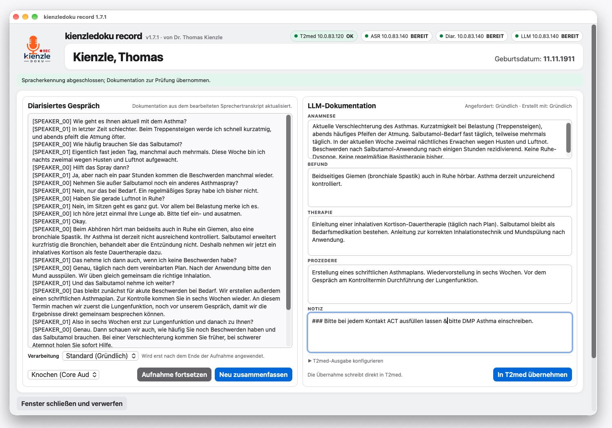
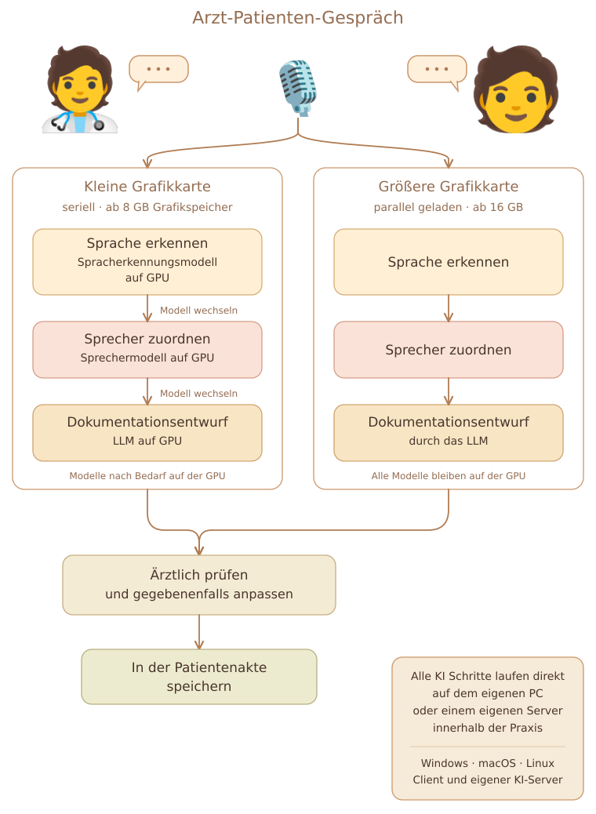
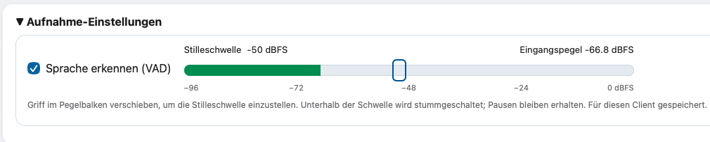
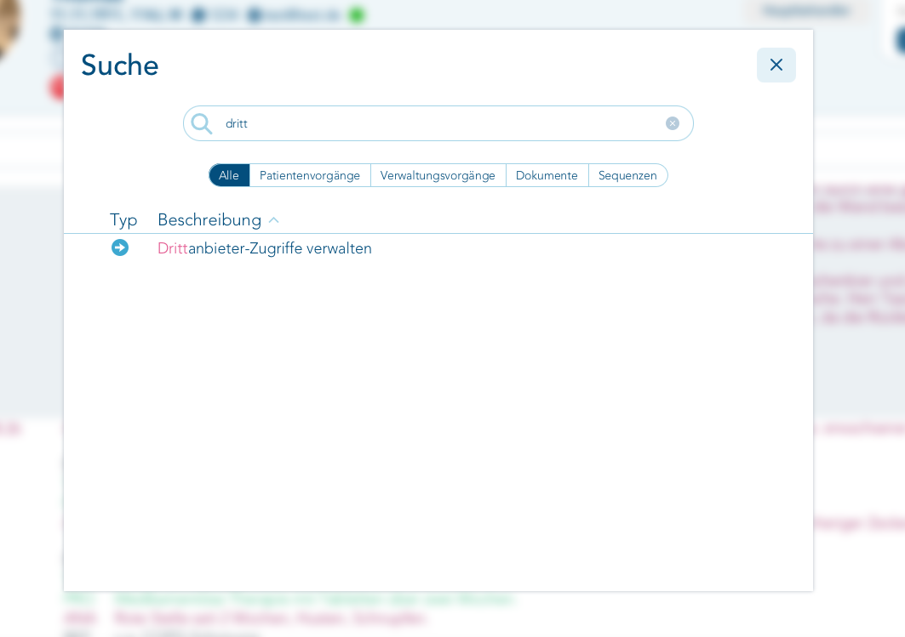
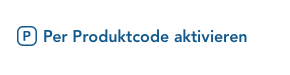
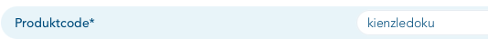
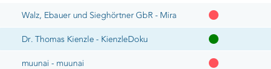
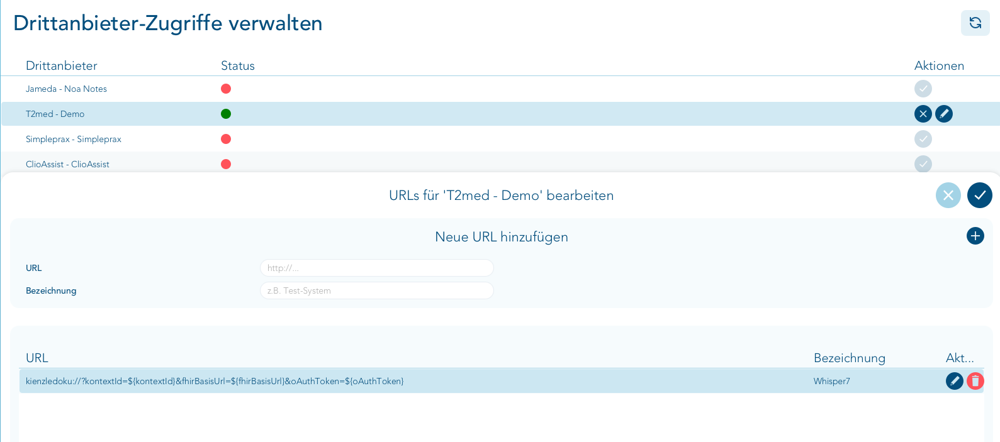

# KienzleDoku



KienzleDoku ist **Open Source und kostenlos**. Die Software erstellt aus dem
Arzt-Patienten-Gespräch einen strukturierten
Dokumentationsentwurf für **T2med**. Die KI verarbeitet das Gespräch auf dem
eigenen Rechner oder einem eigenen Server innerhalb der Praxis. Sie prüfen und
bearbeiten den Entwurf und übernehmen ihn anschließend bewusst in die Patientenakte.

## Download und Installation

Die gemeinsame Installer-Version für **Windows, macOS und Linux** wird nach
Freigabe hier bereitgestellt. **Aktuell sind noch keine gemeinsamen Installer
als GitHub-Release veröffentlicht.** Diese Anleitung und die Videos beschreiben
den neuen Installerstand; der bisherige Quellcode auf `main` ist noch älter.

**Vor der Serverinstallation:** [Hugging-Face-Token einrichten](docs/installation.md#hugging-face-token-einrichten) – Konto, Modellfreigabe, Lesetoken und Eingabe im Installer.

| Betriebssystem | Download und Anleitung | Installationsvideo |
| --- | --- | --- |
| Windows x64 | [Windows installieren](docs/installation.md#windows) | [Unter Windows installieren](https://www.youtube.com/watch?v=RlPRxwvj6ks) |
| macOS / Apple Silicon | [Mac installieren](docs/installation.md#macos) | [Unter Mac und Linux installieren](https://www.youtube.com/watch?v=_Mn_QjbPdmc) |
| Ubuntu 24.04 / x86_64 | [Linux installieren](docs/installation.md#linux) | [Unter Mac und Linux installieren](https://www.youtube.com/watch?v=_Mn_QjbPdmc) |

[Veröffentlichte Pakete auf GitHub](https://github.com/thomaskien/kienzledoku/releases)
· [Homepage](https://kienzledoku.de/)

Die Installer bieten **Client, Server oder beides**. Der Client braucht ein
Mikrofon sowie Zugang zu T2med und zum Commander. Für den KI-Server ist passende
Hardware erforderlich; er kann auf einem anderen Rechner im Praxisnetz laufen.

Der vorbereitete Linux-Kurzaufruf für einen Server lautet:

```bash
wget -O install_linux.sh https://kienzledoku.de/install_linux.sh && \
bash install_linux.sh --components server
```

Der Starter lädt ein freigegebenes Linux-Paket und dessen SHA-256-Prüfsumme,
prüft und entpackt es und startet den enthaltenen Installer. Solange kein
passendes Release vorliegt, beendet er sich mit einer Erklärung ohne Installation.
[Linux-Voraussetzungen und weitere Optionen](docs/installation.md#linux).

## Videos

| Reihenfolge | Video |
| --- | --- |
| 1 | [Unter Windows installieren](https://www.youtube.com/watch?v=RlPRxwvj6ks) |
| 2 | [Unter Mac und Linux installieren](https://www.youtube.com/watch?v=_Mn_QjbPdmc) |
| 3 | [KienzleDoku mit 8 GB Grafikspeicher](https://www.youtube.com/watch?v=09TLE3R1GjU) |
| 4 | [Mikrofontest](https://www.youtube.com/watch?v=spvwjsQWLHA) |
| 5 | [GPU-Unlock unter Windows](https://www.youtube.com/watch?v=k0Zndclce9A) |
| 6 | [Lasttest](https://www.youtube.com/watch?v=-isFceLORfQ) |
| 7 | [Erstvorstellung KienzleDoku](https://www.youtube.com/watch?v=6l1U047NSwg) |

## Hardware und Modelle

Modellgröße, Grafikspeicher und Arbeitsspeicher bestimmen, welche Modelle passen
und wie schnell sie arbeiten. Mit passenden Modellen und seriellem Modellwechsel
ist der NVIDIA-Serverbetrieb ab **8 GB Grafikspeicher** vorgesehen; Apple Silicon
verwendet gemeinsamen Arbeitsspeicher. Die Benchmarks vergleichen Qualität,
Laufzeiten und Speicherbedarf und kennzeichnen Messwerte und Schätzungen.

[Benchmarks und Modelle](https://kienzledoku.de/benchmarks.html): Qualität und Geschwindigkeit der Sprachmodelle.

[Grafikkarten Kaufberatung](https://kienzledoku.de/grafikkarten.html)
· [Voraussetzungen](docs/installation.md)

Bitte Netzteil beachten, 750W sinnvoll (ab 50 Euro)

## Technischer Ablauf

Gespräch aufnehmen → Sprache als Text erkennen → optional Sprecher zuordnen →
Dokumentationsentwurf erstellen → **ärztlich prüfen** → in T2med übernehmen.
Der **Commander** steuert die KI-Dienste; **Connect** vermittelt den T2med-Aufruf.
„Parallel geladen“ bedeutet, dass Modelle gleichzeitig im Speicher bleiben.
Die Verarbeitungsschritte folgen weiterhin aufeinander.



[Technik und Betriebsarten](docs/technik.md)

## Pegel einstellen



Bitte die **Stilleschwelle** so einstellen, dass auch leise Sprache erkannt wird.
Eine zu empfindliche Einstellung kann Halluzinationen bei der Texterkennung
begünstigen – also Text, der gar nicht gesprochen wurde.

Die Schwelle sollte über den Hintergrundgeräuschen und unter leiser Sprache
liegen. **−60 dBFS ist empfindlicher als −40 dBFS.** „Sprache erkennen (VAD)“
hilft zusätzlich, Geräusche von Sprache zu unterscheiden. Die Stilleschwelle
wirkt auch ohne VAD. Einstellungen werden für diesen Client gespeichert.

## T2med einrichten und verwenden

Diese Anleitung gehört zum gemeinsamen Installerstand. Die öffentlichen Pakete
werden nach Freigabe ergänzt; die älteren Quellcode-Installer sind separat im
[Archiv](docs/archiv/direktbetrieb.md) beschrieben.


Nach der Client-Installation wird kienzledoku record in T2med als
Drittanbieter-URL hinterlegt. Die Darstellung kann je nach T2med-Version
geringfügig abweichen.

1. In der T2med-Suche `dritt` eingeben und
   **Drittanbieter-Zugriffe verwalten** öffnen.

   

2. **Per Produktcode aktivieren** wählen.

   

3. In das Feld **Produktcode** genau `kienzledoku` eingeben und die Aktivierung
   bestätigen.

   

4. In der Liste erscheint **Dr. Thomas Kienzle - KienzleDoku** mit einem
   **grünen Statuspunkt**. Daran ist die erfolgreiche Aktivierung erkennbar.

   

5. Den Eintrag für die URL-Einrichtung über das Stiftsymbol bearbeiten.
   Für den gemeinsamen Installer den zuvor aktivierten Eintrag **KienzleDoku** verwenden.
6. Eine neue URL hinzufügen. Für den Aufruf über **Connect** diese vollständige
   Zeile kopieren und unverändert einfügen:

   ```text
   kienzledoku://record?kontextId=${kontextId}&fhirBasisUrl=${fhirBasisUrl}&oAuthToken=${oAuthToken}
   ```

7. Als Bezeichnung **kienzledoku record** eintragen.
8. Den URL-Eintrag und anschließend den Drittanbieterzugriff jeweils mit dem
   Häkchen speichern. Der Eintrag sollte danach als aktiv angezeigt werden.

   

   Der Screenshot zeigt einen älteren Eintrag mit der Bezeichnung `Whisper7`
   und einer alten URL. Bitte die passende aktuelle URL aus Schritt 6 verwenden.

9. Einen **Knopf in der Menüleiste einrichten** und ihm den soeben angelegten
   Drittanbieter-Eintrag **kienzledoku record** zuweisen. Damit wird Record für
   den aktuell geöffneten Patienten gestartet.

T2med ersetzt die Platzhalter selbst. Hinweise zu älteren Einträgen und zum
Direktbetrieb stehen im [Archiv](docs/archiv/direktbetrieb.md).

Aufnahme, Transkript und Entwurf bleiben im neuen Installerstand im Arbeitsspeicher.
**Schließen verwirft die offene Arbeit.** Erst die bewusste Übernahme schreibt
in T2med; vorher alle Felder ärztlich prüfen.

[Aufnahme, Prüfung und Übernahme im Detail](docs/bedienung.md)

## Weiterführende Informationen

- [Installation, Updates und Deinstallation](docs/installation.md)
- [Technik, Konfiguration und Fehlerhilfe](docs/technik.md)
- [Historisches zu Direktbetrieb und Connect](docs/archiv/direktbetrieb.md)
- [Änderungsverlauf](CHANGELOG.md) · [Sicherheit](SECURITY.md)

Entwicklungs- und Integrationsstand. Vor dem Einsatz den gesamten Ablauf mit
Testpatienten in der eigenen Umgebung prüfen.
