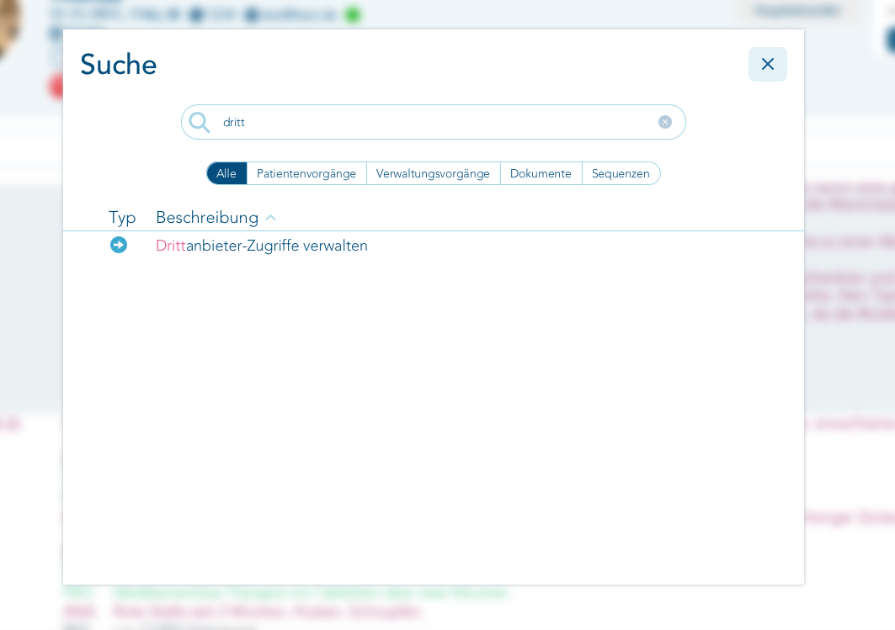
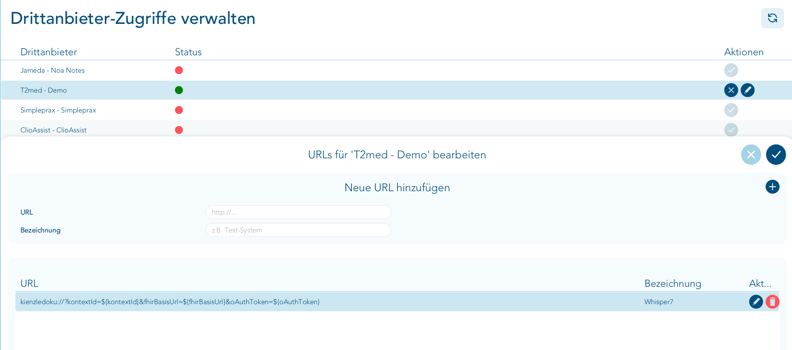

# kienzledoku record 1.3.3

kienzledoku record erstellt aus einem Arzt-Patienten-Gespräch einen strukturierten
Dokumentationsentwurf. Nach ärztlicher Prüfung wird er ausdrücklich in die
aktuell in T2med geöffnete Patientenakte übernommen. Der Client läuft auf
Windows, macOS oder Linux. Der Commander nimmt ASR-, Sprechertrennungs- und
LLM-Aufträge unter einer gemeinsamen Adresse an und steuert die Modellwechsel.
Client und Server können auf demselben Rechner oder getrennt im Praxisnetz laufen.

[](https://www.youtube.com/watch?v=6l1U047NSwg)

**Video:** [Lokaler KI-Dokumentationsassistent für T2med](https://www.youtube.com/watch?v=6l1U047NSwg)

**Entwicklungsstand vom 10.11.2026:** Die Commander-Anbindung ist mit der
bestehenden Record-1.3.3-/Connect-Oberfläche zusammengeführt. Der Linux-Servercode
stammt aus der mit dem installierten Server abgeglichenen Übergabe. Der vom
Benutzer als funktionierend bestätigte Windows-Server-Installer **1.12** ist
unverändert enthalten. Die neue Client-Integration ist separat zu prüfen;
Details stehen im [Integrationsnachweis](docs/commander-integration-2026-11-10.md).

## Funktionsumfang

- Automatische Mikrofonaufnahme beim Patientenaufruf aus T2med, während die
  Patientendaten parallel geladen werden; Live-Transkript,
  optionale Sprechertrennung und nachträglich editierbarer Dokumentationsentwurf.
- Vier strukturierte Einträge (Anamnese, Befund, Therapie, Prozedere) oder ein
  gemeinsamer Freitext-Eintrag mit wählbarem Kürzel, standardmäßig `KI`.
- Eine atomare FHIR-Transaktion nach bewusster Freigabe; keine automatische
  Wiederholung einer möglicherweise bereits ausgeführten Übertragung.
- Eigenes Fenster mit dem vorhandenen Record-Logo: WebView2 unter Windows,
  WKWebView unter macOS und WebKitGTK unter Linux.
- Grafische Einstellungen, Mikrofonauswahl mit stabiler Gerätekennung,
  Pegelanzeige, Mikrofontest und Umrechnung auf Mono/16 kHz/PCM16.
- Sichern und Wiederherstellen offener Arbeit; ein aktiver Patientenkontext
  je Anmeldesitzung, ohne Überschreiben durch einen zweiten Patientenaufruf.

## Direktbetrieb und Connect

Die gemeinsame Anwendung unterstützt beide ausdrücklich gewählten Betriebsarten:

| Betriebsart | Start-URL | API-Key |
| --- | --- | --- |
| Direktbetrieb | `kienzledoku-record://record` | Eigener gespeicherter Key, sonst Demo-Key |
| Über Connect | `kienzledoku://record` | Ausschließlich der in Connect eingebettete Key |

**Zunächst verwenden beide Varianten den öffentlichen Demo-Key.** Connect
entfernt jeden eingehenden `X-API-Key`, auch bei mehrfachen Headern, und setzt
seinen eingebetteten Key. Methode, FHIR-Pfad, Query, Body, OAuth und fachliche
Header bleiben erhalten; Status und Antwortinhalt werden durchgereicht.
Transportheader wie Host werden für die Weiterleitung angepasst.

Patientenlogik, FHIR-Aufbau, medizinische Prüfung und Wiederherstellung liegen
in Record. Connect enthält keine zweite FHIR-Fachlogik. Es lauscht nur an einem
zufälligen Loopback-Port und verlangt eine private Sitzungsberechtigung.
Der Direktbetrieb benötigt kein installiertes oder laufendes Connect.
Die TOML-Einstellung bestimmt den Weg; ein Connect-Ausfall schaltet ihn nicht um.

## Client installieren

### Windows x64

Das Build-Paket entpacken, die Voraussetzungen aus
[windows/README.md](windows/README.md) installieren und **`windows\build.cmd`**
starten. Es erzeugt ein ZIP mit eigener Python-Laufzeit sowie ein Inno-Setup.
Auf späteren Zielrechnern sind keine Entwicklungswerkzeuge nötig. Das Setup
wartet auf die Servereinrichtung für T2med und Commander.
Vorhandene Werte sind vorbelegt; erst Speichern übernimmt Änderungen.

### macOS Intel und Apple Silicon

```bash
./install_macos.command
```

Python >= 3.9 wird benötigt. Der Client legt eine eigene Python-Umgebung an.
Der native Fenstercontainer liegt als Universal-Binary bei. Connect kann
mit `./build_connect.sh` aus Go >= 1.20 gebaut werden; das vorbereitete
Client-Quellpaket enthält bereits das universelle macOS-Connect-Binary.
Der Installer erstellt `~/Applications/kienzledoku record.app` und den
separaten URL-Starter `kienzledoku connect.app`.

### Ubuntu 24.04 LTS x86_64

```bash
./install_linux.sh
```

Der Installer richtet Python, PortAudio, Go, GTK/WebKitGTK und die
Desktopintegration ein. Der native Fenstercontainer liegt root-eigen unter
`/usr/local/libexec/kienzledoku`. Das bestehende begrenzte AppArmor-Profil
bleibt erhalten; die WebKit-Sandbox wird nicht abgeschaltet.
`--skip-packages` überspringt die Systempakete, `--non-interactive` das Öffnen
der Einstellungen. Frühere direkte URL-Schemata lassen sich zusätzlich mit
`--legacy-url-schemes` registrieren.

### Updates und Einstellungen

Vorhandene Einstellungen und eigene Direkt-Keys bleiben erhalten. Eine alte
`config.json` wird gelesen und bei der Installation in TOML übernommen.
Eine neue Installation kann mit `--config /pfad/config.toml` vorbelegt werden;
Windows verwendet `install.ps1 -Config C:\Pfad\config.toml`.

Die Startmenü-/Programmverknüpfung ohne Patientenaufruf öffnet die Einstellungen.
Dort Betriebsart, genaue T2med-Basis, Dienstadressen, Zertifikatsoption und
Mikrofon auswählen. Änderungen gelten für den nächsten Patientenvorgang.

| Plattform | Konfiguration |
| --- | --- |
| Windows | `%LOCALAPPDATA%\kienzledoku record\config.toml` |
| macOS | `~/Library/Application Support/Kienzledoku/config.toml` |
| Linux | `$XDG_CONFIG_HOME/kienzledoku/config.toml`, sonst `~/.config/kienzledoku/config.toml` |

Eine vollständige Vorlage steht in [config.example.toml](config.example.toml).
Patientenkontext, OAuth und API-Keys gehören nicht in diese Datei. Eigene Keys
werden grafisch im Betriebssystemspeicher hinterlegt: DPAPI, macOS-Schlüsselbund
bzw. Linux Secret Service. `KIENZLEDOKU_T2MED_API_KEY` bleibt für den
Direktbetrieb als Entwickler-Override möglich.

## T2med einrichten und verwenden

### Drittanbieter-Zugriff einrichten

Nach der Client-Installation wird kienzledoku record in T2med als
Drittanbieter-URL hinterlegt. Die Darstellung kann je nach T2med-Version
geringfügig abweichen.

1. In der T2med-Suche `dritt` eingeben und
   **Drittanbieter-Zugriffe verwalten** öffnen.

   

2. Für den derzeit verwendeten Demo-Key **T2med - Demo** auswählen und über
   das Stiftsymbol bearbeiten.
3. Eine neue URL hinzufügen. Für den Aufruf über **Connect** diese vollständige
   Zeile kopieren und unverändert einfügen:

   ```text
   kienzledoku://record?kontextId=${kontextId}&fhirBasisUrl=${fhirBasisUrl}&oAuthToken=${oAuthToken}
   ```

   Bei ausdrücklich gewähltem **Direktbetrieb** stattdessen diese URL verwenden:

   ```text
   kienzledoku-record://record?kontextId=${kontextId}&fhirBasisUrl=${fhirBasisUrl}&oAuthToken=${oAuthToken}
   ```

4. Als Bezeichnung **kienzledoku record** eintragen.
5. Den URL-Eintrag und anschließend den Drittanbieterzugriff jeweils mit dem
   Häkchen speichern. Der Eintrag sollte danach als aktiv angezeigt werden.

   

   Der Screenshot zeigt einen älteren Eintrag mit der Bezeichnung `Whisper7`
   und einer alten URL. Bitte die passende aktuelle URL aus Schritt 3 verwenden.

6. Einen **Knopf in der Menüleiste einrichten** und ihm den soeben angelegten
   Drittanbieter-Eintrag **kienzledoku record** zuweisen. Damit wird Record für
   den aktuell geöffneten Patienten gestartet.

Alte Einträge mit `kienzledoku://?…` müssen beim Wechsel zum Connect-Starter
auf das neue Muster aktualisiert werden. T2med ersetzt die Platzhalter selbst.

### Aufnahme und Übernahme

1. Testpatient öffnen und Record starten; Patientennamen prüfen.
2. Aufnahme stoppen, Transkript und alle Dokumentationsfelder prüfen/korrigieren.
3. Bei Bedarf fortsetzen oder das Sprechertranskript erneut zusammenfassen.
4. **In T2med übernehmen** schreibt die atomare Transaktion und schließt Record.

**Sichern und schließen** bewahrt offene Arbeit im Sitzungsverzeichnis unterhalb
der Konfiguration. Beim Aufruf desselben Kontextes ist eine bewusste
Wiederherstellung möglich. Gesichertes Audio wird erst nach ausdrücklicher
Fortsetzung verarbeitet. **Vorgang verwerfen** löscht diese Arbeit. Erfolgreiche
Übernahme entfernt ebenfalls Wiederherstellungsdaten und Audio-Zwischendateien.

Ein unklarer Schreibausgang sperrt weitere Übernahmen. Erst in T2med prüfen,
ob die Dokumentation vorhanden ist. Nur bei sicher **nicht** erfolgter Übernahme
darf der Vorgang erneut zum Schreiben freigegeben werden.

## Commander und Serverinstallation

Im Commander-Betrieb verwendet Record ausschließlich dessen Adresse, normalerweise
`http://SERVER:8185`. Der Server liefert die verfügbaren Modelle und ihre Namen.
Er übernimmt Queue, Speicherverwaltung und serielle oder parallele Verarbeitung.
Connect vermittelt weiterhin ausschließlich die T2med-Anbindung.

- **Windows-Server 1.12:** [Setup herunterladen](server-windows/dist/kienzledoku-Server-Installer-1.12.exe?raw=1),
  [portables ZIP](server-windows/dist/kienzledoku-Server-Installer-1.12.zip?raw=1),
  [Anleitung und Quellen](server-windows/README.md). Enthält Commander und die
  KI-Laufzeit in einer eigenen WSL2-Umgebung; lokal neben Record oder als Server
  für andere Arbeitsplätze verwendbar. Die Originalpakete wurden nicht neu gebaut.
- **Linux-Commander:** [Installation und API](server-linux/commander/README.md).
  Der enthaltene Installer ergänzt die bestehenden, unterstützten Linux-Worker.
- **Bisherige getrennte Dienste:** [Ubuntu/NVIDIA](server-linux/README.md) und
  [Apple Silicon](local-ai-macos/README.md). Ihre Installer bleiben erhalten.
  Die integrierte Commander-Installation für alle Plattformen folgt separat.

Neue Client-Konfigurationen verwenden Commander. Bestehende Konfigurationen ohne
Commander behalten zunächst ihre getrennten Dienstadressen; in den Einstellungen
lässt sich Commander gezielt aktivieren. Ein Commander-Ausfall schaltet nicht
automatisch auf diese Dienste um. FHIR-Direktbetrieb und FHIR über Connect sind
unabhängig von dieser KI-Verbindung wählbar.

## Sicherheitsgrenzen

Der Demo-Key ist laut bestehender T2med-Integrationsvorgabe auf **100 einzelne
FHIR-Requests pro APS-Serverprozess** begrenzt; Reads und Writes zählen jeweils.
Er wird auch im ersten Connect-Build verwendet.

Record akzeptiert ausschließlich das konfigurierte HTTPS-FHIR-Ziel samt
Host, Port und Basispfad. TLS wird standardmäßig geprüft; eine eigene CA oder
eine ausdrücklich gewählte Ausnahme für dieses Ziel ist möglich. Bei der
Migration alter Installationen bleibt deren bisherige Zertifikatsausnahme erhalten.

OAuth und API-Keys werden nicht protokolliert oder in TOML gespeichert.
Offene Entwürfe und Audio zur Wiederherstellung liegen im geschützten
Benutzerprofil und sind nicht zusätzlich verschlüsselt. Bei Abstürzen bleiben
sie bewusst erhalten. Zugriffs- und Aufbewahrungsregeln legt der Betreiber fest.
Die KI-Dienste sind weiterhin für das kontrollierte Praxisnetz vorgesehen.

Die Dokumentation ist ein Entwurf und benötigt ärztliche Prüfung. Dies ist ein
Entwicklungs- und Integrationsstand. Vor regulärem Einsatz sind T2med, Mikrofon,
Windows-Fenster sowie gegebenenfalls RDP in der tatsächlichen Umgebung zu testen.
Hinweise zu vertraulichen Meldungen stehen in [SECURITY.md](SECURITY.md).

## Tests und Entwicklung

```bash
python3 -m pip install -r requirements-asr-client.txt
python3 kienzledoku.py --self-test
./build_connect.sh
python3 -m unittest discover -s tests -v
(cd connect && go test ./...)
./install_linux.sh --self-test
```

Die Tests verwenden synthetische Daten. Der HTTPS-Integrationstest startet
lokale Testserver; seine ausschließlich dafür erzeugten Zertifikate sind
öffentliche Testfixtures. Ohne gebautes Connect wird dieser eine Test übersprungen.
Der Windows-Build führt ihn ausdrücklich mit dem frisch gebauten Binary aus.

Gemeinsame Änderungen müssen Windows, macOS und Linux kompatibel halten.
Plattformfunktionen bleiben getrennt; Testabnahme je Plattform siehe
[RELEASE-CHECKLIST.md](RELEASE-CHECKLIST.md).

## Deinstallation

Windows: Setup-Deinstallation bzw. `uninstall.ps1`. macOS:
`./uninstall_macos.command`. Linux: `./uninstall_linux.sh`.
Einstellungen, eigene Schlüssel und offene Wiederherstellungsdaten bleiben
bewusst erhalten. KI-Dienste und Modelle werden separat mit ihren eigenen
Installern entfernt.
