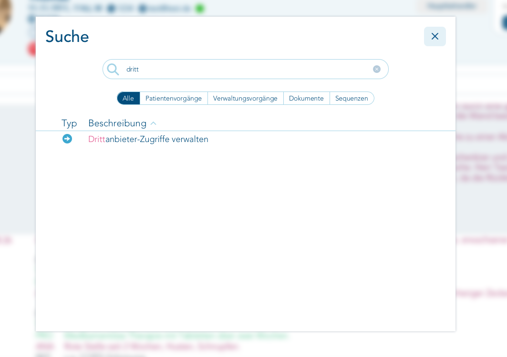
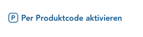
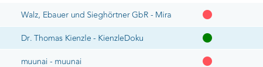
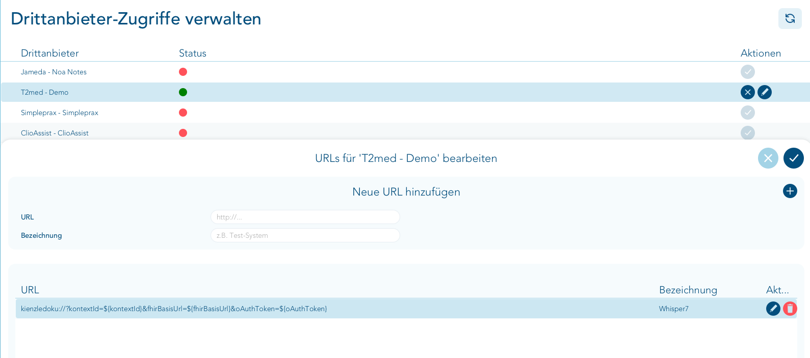

# Archiv: Dokumentation vor der Überarbeitung am 15.11.2026

Historischer, unveränderter Textstand der lokalen README. Enthält überholte und
teils widersprüchliche Angaben; keine aktuelle Installationsanleitung.
Aktueller Einstieg: [README](../../README.md). Relative Links wurden angepasst; noch nicht veröffentlichte Ziele sind als historische Pfadangaben erhalten.

---

# kienzledoku record 1.7.4

kienzledoku record erstellt aus einem Arzt-Patienten-Gespräch einen strukturierten
Dokumentationsentwurf. Nach ärztlicher Prüfung wird er ausdrücklich in die
aktuell in T2med geöffnete Patientenakte übernommen. Der Client läuft auf
Windows, macOS oder Linux. Der Commander nimmt ASR-, Sprechertrennungs- und
LLM-Aufträge unter einer gemeinsamen Adresse an und steuert die Modellwechsel.
Client und Server können auf demselben Rechner oder getrennt im Praxisnetz laufen.

[](https://www.youtube.com/watch?v=6l1U047NSwg)

**Video:** [Lokaler KI-Dokumentationsassistent für T2med](https://www.youtube.com/watch?v=6l1U047NSwg)

**Version 1.7.4:** gemeinsame Ausgabe für macOS, Linux und Windows mit eingebettetem
Hersteller-Key. Mac und Windows verwenden grafische Assistenten, Linux bleibt
textbasiert. Die Installer bieten Client, Server oder beide Komponenten sowie
Deinstallation. Die praktische Installationsabnahme erfolgt auf den Zielsystemen.
Die Herkunft der übernommenen Commander-Version beschreibt der
[Integrationsnachweis](../commander-integration-2026-11-10.md).

Neu in 1.7.4: Windows richtet fehlende Microsoft-C++-Laufzeitbibliotheken für VAD
automatisch ein und prüft die lokale Sprachaktivitätserkennung vor der weiteren
Installation. Alle Windows-Python-Abhängigkeiten einschließlich `pyreadline3`
werden beim Build geprüft. Mac und Linux übernehmen die gemeinsame Commander-
Einrichtung und präzisere VAD-Fehlermeldungen aus dem aktuellen Clientstand.
Die Mac-Statusanzeige bleibt wie in 1.7.1; die Windows-Anpassung gegen Umbrüche
gilt nur dort. Die Serververarbeitung bleibt gegenüber 1.7.1 unverändert.

Neu in 1.7.1: Mac-Updates schließen auch dann korrekt ab, wenn alte App-Sicherungen
nicht bei Launch Services registriert waren. Die Verarbeitungsauswahl zeigt wieder
**Basis**, **Gründlich** und **Sehr gründlich**. VAD, Pegel und Stilleschwelle stehen
während der Aufnahme im eingeklappten Bereich **Aufnahme-Einstellungen** unmittelbar
über den technischen Informationen. Gespeicherte Clientwerte bleiben erhalten.
Fehlgeschlagene Verzeichnisaustausche behalten die Sicherung auch dann, wenn eine
sofortige Wiederherstellung nicht möglich ist.

Seit 1.7: Unabhängige Mac-Updates für Client und Server. Ersetzte Dateien und
unbenutzte Versionsverzeichnisse werden nach bestätigter Aktivierung entfernt;
nicht ausgewählte Komponenten behalten ihre benötigten Dateien und Einstellungen.
Linux/WSL prüft nach einer unterbrochenen systemd-Rückmeldung den tatsächlichen
Start, ohne einen Neustart blind zu wiederholen.

Seit 1.6: Live-Pegel und Stilleschwelle, lokal ausgeführtes VAD mit gespeicherten
Clientwerten, vollständiger Austausch alter Programmbäume beim Update sowie
korrigierte Linux-Stufenabfragen und Modellidentität für residente LLMs.

## Funktionsumfang

- VAD-Schalter und Stilleschwelle (−80 bis −20 dBFS) live im Aufnahmefenster;
  Erstinstallation mit VAD an und −50 dBFS. Die beiden Werte bleiben lokal für
  diesen Client in `config.toml` erhalten. Andere Clients und offene Sitzungen
  behalten ihre eigenen Einstellungen. Der Balken zeigt den Eingang vor dem Gate.
  Änderungen wirken künftig, bereits erkannter Text bleibt unverändert.
- Stille wird in der ASR-Kopie zeitgetreu auf null gesetzt (200 ms Vorlauf,
  300 ms Nachlauf); Originalaudio bleibt im RAM für die Sprecherzuordnung.
  Lokales Silero-VAD verhindert Whisper-Aufrufe für erkannte Nichtsprachabschnitte.
  Getrennte Sprachfenster behalten Pausenränder und Originalzeitstempel.
  Ohne erkannte Sprache wird keine neue LLM-Dokumentation erstellt.
  Für sehr leise Sprache die Schwelle absenken; VAD ist ausdrücklich abschaltbar.
- Automatische Mikrofonaufnahme beim Patientenaufruf aus T2med, während die
  Patientendaten parallel geladen werden; Live-Transkript,
  optionale Sprechertrennung und nachträglich editierbarer Dokumentationsentwurf.
- Im Installer wählbare Felder: Anamnese, Befund, EKG (`EKG`), Sonografie (`SON`),
  Therapie, Prozedere und Notiz (`NOT`), in dieser Reihenfolge. Ohne passende
  diktierte Information bleiben die Felder leer. Alternativ gemeinsamer
  Freitext-Eintrag mit wählbarem Kürzel, standardmäßig `KI`.
- Eine atomare FHIR-Transaktion nach bewusster Freigabe; keine automatische
  Wiederholung einer möglicherweise bereits ausgeführten Übertragung.
- Eigenes Fenster mit dem vorhandenen Record-Logo: WebView2 unter Windows,
  WKWebView unter macOS und WebKitGTK unter Linux.
- Grafische Einstellungen, Mikrofonauswahl mit stabiler Gerätekennung,
  Pegelanzeige, Mikrofontest und Umrechnung auf Mono/16 kHz/PCM16.
- Aufnahme und Entwurf nur im Arbeitsspeicher des offenen Fensters. Schließen
  verwirft die Arbeit. Ein zweiter Patientenaufruf zeigt eine deutliche Warnung
  mit beiden Patienten; zuerst muss das offene Fenster geschlossen werden.

## Direktbetrieb und Connect

Die gemeinsame Anwendung unterstützt beide ausdrücklich gewählten Betriebsarten:

| Betriebsart | Start-URL | API-Key |
| --- | --- | --- |
| Direktbetrieb | `kienzledoku-record://record` | In Release 1.7.4 eingebetteter Hersteller-Key; öffentliche Quellcode-Builds verwenden den Demo-Key |
| Über Connect | `kienzledoku://record` | Ausschließlich der in Connect eingebettete Key |

**Die Installer 1.7.4 für Mac, Linux und Windows verwenden in beiden Varianten den endgültigen KienzleDoku-Hersteller-Key.**
Öffentliche Quellcode-Builds ohne privaten Build-Eingang und die bisherigen
Öffentliche Quellcode-Builds ohne private Einbindung verwenden weiterhin den Demo-Key. Connect
entfernt jeden eingehenden `X-API-Key`, auch bei mehrfachen Headern, und setzt
seinen eingebetteten Key. Methode, FHIR-Pfad, Query, Body, OAuth und fachliche
Header bleiben erhalten; Status und Antwortinhalt werden durchgereicht.
Transportheader wie Host werden für die Weiterleitung angepasst.

Patientenlogik, FHIR-Aufbau und medizinische Prüfung liegen
in Record. Connect enthält keine zweite FHIR-Fachlogik. Es lauscht nur an einem
zufälligen Loopback-Port und verlangt eine private Sitzungsberechtigung.
Der Direktbetrieb benötigt kein installiertes oder laufendes Connect.
Die TOML-Einstellung bestimmt den Weg; ein Connect-Ausfall schaltet ihn nicht um.

## Client installieren

### Windows x64

`kienzledoku-1.7.4-windows-x64-setup.exe` starten und Client, Server oder beides
wählen. Python und das Aufnahmefenster sind enthalten. Der Server-Assistent
fragt Modelle, Stufen, Felder und Prompt ab. Anschließend folgen T2med und
Commander für den Client sowie die kopierbare Drittanbieter-Adresse.
[Windows-Anleitung](../../windows/README.md).

### macOS: grafischer Installer

Die Datei `kienzledoku-1.7.4-macOS-arm64.dmg` öffnen und **kienzledoku Installation**
doppelklicken. Die Python-Laufzeit ist enthalten; Homebrew und Entwicklungswerkzeuge
sind auf dem Zielrechner nicht erforderlich. Das Testpaket ist lokal signiert,
aber noch nicht von Apple notarisiert.

Der Assistent führt durch Komponenten, Verbindungen, Modelle, Dokumentationsfelder,
Prompt und Zusammenfassung. Erst **Installieren** übernimmt die Auswahl.
Über **Deinstallieren …** auf der Startseite lassen sich Client, Server oder beide
entfernen. Modelle und technische Einstellungen bleiben standardmäßig erhalten;
ihre Entfernung muss gesondert gewählt werden. Offene Aufnahmefenster blockieren
die Deinstallation.
Der lokale KI-Server benötigt Apple Silicon mit mindestens 16 GB gemeinsamem
Arbeitsspeicher. Der Modellauswahl liegen Speichergrenzen zugrunde; der echte
Modellbetrieb wird bei der anschließenden Abnahme geprüft.

| Stufe | Vorausgewähltes Modell bei ausreichendem Speicher |
| --- | --- |
| Basis | Qwen3.5 4B Q4 |
| Gründlich | Gemma 4 12B Q8 |
| Sehr gründlich | Qwen3.8 27B Q4 |

Mehrere Modelle derselben Stufe lassen sich installieren. Die aktive Zuordnung
wird im Installer oder in `commander/config.toml` gewählt. Record zeigt nur die
Stufen; bei genau einer verfügbaren Stufe entfällt das Auswahlmenü.

Für die optionale Sprechertrennung verlangt Hugging Face die Annahme der
Modellbedingungen und ein Lesetoken. Der Assistent zeigt den Link und fragt das
Token ab; es wird nur für den Download verwendet.

Nach der Client-Installation zeigt der Assistent die T2med-Einrichtung mit
kopierbarer vollständiger URL, Screenshots und Link zur ausführlichen Anleitung.
Installierte Programme: `~/Applications/kienzledoku record.app` und
`~/Applications/kienzledoku connect.app`. Zum Ändern von Modellen, Feldern oder
Prompt den Assistenten erneut öffnen. Vor dem Aktualisieren Patientenfenster schließen.

Der bisherige Client-Installer `./install_macos.command` bleibt für Intel- und
Apple-Silicon-Macs verfügbar und benötigt Python >= 3.9. Er richtet ausschließlich
den Client ein. Der neue grafische Build wird mit
`python3.12 installer/build_macos.py --arch arm64` erzeugt; `--arch x86_64` erstellt
bei Bedarf ein Intel-Paket für den Clientbetrieb.

### Ubuntu 24.04 LTS x86_64

```bash
./install_linux.sh
```

Das Paket `kienzledoku-1.7.4-linux-x86_64.tar.gz` enthält den textbasierten
Installer für Client, Server oder beides. Als normaler Benutzer starten;
Systemrechte werden über sudo angefordert. Ein lokaler Server setzt eine
unterstützte NVIDIA-GPU voraus. Linux-Anleitung (`../../linux/README.md` im damaligen Arbeitsstand).

Entpacken und die Serverinstallation als root starten (Client-Installation als
angemeldeter Desktop-Benutzer ausführen):

```bash
sha256sum -c kienzledoku-1.7.4-linux-x86_64.tar.gz.sha256
tar -xzf kienzledoku-1.7.4-linux-x86_64.tar.gz
cd kienzledoku-1.7.4-linux-x86_64
./install_linux.sh --components server
```


### Updates und Einstellungen

Vorhandene Einstellungen und eigene Direkt-Keys bleiben erhalten. Eine alte
`config.json` wird gelesen und bei der Installation in TOML übernommen.
Der separate Client-Helfer `linux/install_client.sh` kann bei Erstinstallation
mit `--config /pfad/config.toml` vorbelegt werden;
Windows verwendet `install.ps1 -Config C:\Pfad\config.toml`.

Die Startmenü-/Programmverknüpfung ohne Patientenaufruf öffnet die Einstellungen.
Dort Betriebsart, genaue T2med-Basis, Dienstadressen, Zertifikatsoption und
Mikrofon auswählen. Änderungen gelten für den nächsten Patientenvorgang.

| Plattform | Konfiguration |
| --- | --- |
| Windows | `%LOCALAPPDATA%\kienzledoku record\config.toml` |
| macOS | `~/Library/Application Support/Kienzledoku/config.toml` |
| Linux | `$XDG_CONFIG_HOME/kienzledoku/config.toml`, sonst `~/.config/kienzledoku/config.toml` |

Eine vollständige Vorlage steht in [config.example.toml](../../config.example.toml).
Patientenkontext, OAuth und API-Keys gehören nicht in diese Datei. Eigene Keys
werden grafisch im Betriebssystemspeicher hinterlegt: DPAPI, macOS-Schlüsselbund
bzw. Linux Secret Service. `KIENZLEDOKU_T2MED_API_KEY` bleibt für den
Direktbetrieb als Entwickler-Override möglich.

## T2med einrichten und verwenden

### Drittanbieter-Zugriff einrichten

Nach der Client-Installation wird kienzledoku record in T2med als
Drittanbieter-URL hinterlegt. Die Darstellung kann je nach T2med-Version
geringfügig abweichen.

1. In der T2med-Suche `dritt` eingeben und
   **Drittanbieter-Zugriffe verwalten** öffnen.

   

2. **Per Produktcode aktivieren** wählen.

   

3. In das Feld **Produktcode** genau `kienzledoku` eingeben und die Aktivierung
   bestätigen.

   

4. In der Liste erscheint **Dr. Thomas Kienzle - KienzleDoku** mit einem
   **grünen Statuspunkt**. Daran ist die erfolgreiche Aktivierung erkennbar.

   

5. Den Eintrag für die URL-Einrichtung über das Stiftsymbol bearbeiten.
   **Für Version 1.7.4 den zuvor aktivierten Eintrag KienzleDoku verwenden.**
   Nur für die bisherigen Pakete 1.4.3 mit Demo-Key weiterhin
   **T2med - Demo** auswählen.
6. Eine neue URL hinzufügen. Für den Aufruf über **Connect** diese vollständige
   Zeile kopieren und unverändert einfügen:

   ```text
   kienzledoku://record?kontextId=${kontextId}&fhirBasisUrl=${fhirBasisUrl}&oAuthToken=${oAuthToken}
   ```

   Bei ausdrücklich gewähltem **Direktbetrieb** stattdessen diese URL verwenden:

   ```text
   kienzledoku-record://record?kontextId=${kontextId}&fhirBasisUrl=${fhirBasisUrl}&oAuthToken=${oAuthToken}
   ```

7. Als Bezeichnung **kienzledoku record** eintragen.
8. Den URL-Eintrag und anschließend den Drittanbieterzugriff jeweils mit dem
   Häkchen speichern. Der Eintrag sollte danach als aktiv angezeigt werden.

   

   Der Screenshot zeigt einen älteren Eintrag mit der Bezeichnung `Whisper7`
   und einer alten URL. Bitte die passende aktuelle URL aus Schritt 6 verwenden.

9. Einen **Knopf in der Menüleiste einrichten** und ihm den soeben angelegten
   Drittanbieter-Eintrag **kienzledoku record** zuweisen. Damit wird Record für
   den aktuell geöffneten Patienten gestartet.

Alte Einträge mit `kienzledoku://?…` müssen beim Wechsel zum Connect-Starter
auf das neue Muster aktualisiert werden. T2med ersetzt die Platzhalter selbst.

### Aufnahme und Übernahme

1. Testpatient öffnen und Record starten; Patientennamen prüfen.
2. Aufnahme stoppen, Transkript und alle Dokumentationsfelder prüfen/korrigieren.
3. Bei Bedarf fortsetzen oder das Sprechertranskript erneut zusammenfassen.
4. **In T2med übernehmen** schreibt die atomare Transaktion und schließt Record.

**Fenster schließen und verwerfen** sowie das Schließen über den Fensterknopf
verwerfen Aufnahme und Entwurf. Es gibt keine lokale Wiederherstellung und keine
automatische Sicherung. Nur die bewusste Übernahme schreibt die Dokumentation
in T2med. Das offene Fenster wird nicht durch einen Zeitablauf geschlossen.

Beim Fortsetzen erscheint eine Abschnittsmarkierung im Transkript; die
Sprecherzuordnung kann sich zwischen Abschnitten unterscheiden. Die Markierung
geht an das LLM, wird aber nicht als medizinischer Befund übernommen.

Ein unklarer Schreibausgang sperrt weitere Übernahmen. Erst in T2med prüfen,
ob die Dokumentation vorhanden ist. Nur bei sicher **nicht** erfolgter Übernahme
darf der Vorgang erneut zum Schreiben freigegeben werden.

## Commander und Serverinstallation

Im Commander-Betrieb verwendet Record ausschließlich dessen Adresse, normalerweise
`http://SERVER:8185`. Der Server liefert die verfügbaren Modelle und ihre Namen.
Er übernimmt Queue, Speicherverwaltung und serielle oder parallele Verarbeitung.
Connect vermittelt weiterhin ausschließlich die T2med-Anbindung.

- **Windows:** integriertes Setup 1.7.4 mit Server-Assistent 1.7.4;
  [Anleitung und Serverquellen](../../server-windows/README.md).
- **Linux:** textbasierte gemeinsame Einrichtung mit `./install_linux.sh`;
  Anleitung (`../../linux/README.md` im damaligen Arbeitsstand). Die bestehende
  [Commander-API-Dokumentation](../../server-linux/commander/README.md) bleibt verfügbar.
- **macOS:** grafischer Installer; Paket 1.7.4 mit Hersteller-Key und Deinstallation.

Im **verschärften seriellen Modus** lädt Whisper beim ersten Audioblock und
bleibt zwischen den Blöcken geladen. Vor Sprechertrennung beziehungsweise LLM
wird es entladen. Nach der Verarbeitung wird es nicht automatisch nachgeladen;
der nächste Audioblock löst das Laden erneut aus. Währenddessen puffert Record
die Aufnahme im Arbeitsspeicher. Die Statusanzeigen zeigen „wird geladen“ und
„standby“ in Gelb.

Die Sprechertrennung lässt sich unabhängig wählen: **immer geladen**, **zusammen
mit Whisper** oder **seriell nach Whisper und vor dem LLM**. Auf dem M4 wurden
bei einem kurzen synthetischen Test bis zu 5,2 GB einschließlich Metal-Cache
beobachtet; vorläufige Arbeitsreserve: 6 GB. Das ist keine Obergrenze für lange
Gespräche und kein Messwert für NVIDIA.

Ein Aufnahmeabschnitt ist auf **zwei Stunden** begrenzt und wird dann automatisch
abgeschlossen. Danach kann die Aufnahme fortgesetzt werden. Commander und Worker
akzeptieren bis zu 256 MiB Audio je Anfrage; die begrenzte Commander-Warteschlange
hat 512 MiB Nutzlastbudget. Der Verarbeitungstimeout beträgt bis zu zwei Stunden,
der neue Client-Standard vier Stunden einschließlich Warteschlange und Laden.
Erkannter Text bleibt bei fehlgeschlagener Sprecherzuordnung im offenen Fenster
bearbeitbar. Der RAM-Bedarf langer Aufnahmen hängt von Hardware und Modellen ab;
eine vollständige zweistündige Verarbeitung wurde noch nicht auf jeder Plattform
praktisch geprüft. Es erfolgt keine zusätzliche Speicherung auf Datenträger.

Linux übernimmt beim Update die letzte Auswahl einschließlich Betriebsarten,
Modellen, Prompt, Feldern und Verbindungen. Token-Abfragen erklären die unsichtbare
Eingabe und vorhandene Tokens; Downloadfortschritt und Wiederverwendung werden
angezeigt. Alte eindeutig erkannte Dienst-Overrides werden gesichert und migriert.
Mac bereinigt ausschließlich eindeutig eigene verwaiste Modellprozesse und wartet
beim Installationsabschluss auf laufende Modellstarts.

Prompt und Feldauswahl gehören zum Commander. Der Installer bietet einen
editierbaren Prompt und einen Knopf zum Zurücksetzen. Der Commander ergänzt den
festen JSON-Ausgabevertrag der ausgewählten Felder und liefert den aktiven Prompt
an Record; er ist unter **Technische Informationen** einsehbar.
Ein eigener LLM-Commander kann auf einem zweiten Rechner laufen. Dort liegen
dann die maßgeblichen Modelle, Felder und der Prompt. Bei dessen Ausfall erfolgt
kein stiller Wechsel auf ein anderes LLM.

Commander-Zugangstoken sind optional und standardmäßig ausgeschaltet. Der
Installer kann sie abfragen oder erzeugen. Die direkte Commander-Verbindung
verwendet derzeit HTTP; eingebautes HTTPS ist für einen späteren Schritt vorgesehen.

Neue Client-Konfigurationen verwenden Commander. Bestehende Konfigurationen ohne
Commander behalten zunächst ihre getrennten Dienstadressen; in den Einstellungen
lässt sich Commander gezielt aktivieren. Ein Commander-Ausfall schaltet nicht
automatisch auf diese Dienste um. FHIR-Direktbetrieb und FHIR über Connect sind
unabhängig von dieser KI-Verbindung wählbar.

## Sicherheitsgrenzen

Der Demo-Key ist laut bestehender T2med-Integrationsvorgabe auf **100 einzelne
FHIR-Requests pro APS-Serverprozess** begrenzt; Reads und Writes zählen jeweils.
Die offiziellen Installer 1.7.4 für alle drei Plattformen verwenden den endgültigen
Hersteller-Key, privat in den Binärdateien
eingebettet und gegen einfache Klartextsuche geschützt. Gezieltes Reverse
Engineering bleibt eine bekannte, akzeptierte Grenze. Private Schlüsseldateien
und generierte private Build-Quellen gehören nicht in Git oder Release-Beigaben.

Record akzeptiert ausschließlich das konfigurierte HTTPS-FHIR-Ziel samt
Host, Port und Basispfad. TLS wird standardmäßig geprüft; eine eigene CA oder
eine ausdrücklich gewählte Ausnahme für dieses Ziel ist möglich. Bei der
Migration alter Installationen bleibt deren bisherige Zertifikatsausnahme erhalten.

OAuth und API-Keys werden nicht protokolliert oder in TOML gespeichert.
Aufnahmen, Transkripte und Entwürfe werden von Record nicht auf Datenträger
geschrieben. Beim Schließen oder Absturz endet die flüchtige Arbeit. Technische
Konfiguration und Zugangstoken werden getrennt von Patientendaten gespeichert.
Die KI-Dienste sind weiterhin für das kontrollierte Praxisnetz vorgesehen.

Die Dokumentation ist ein Entwurf und benötigt ärztliche Prüfung. Dies ist ein
Entwicklungs- und Integrationsstand. Vor regulärem Einsatz sind T2med, Mikrofon,
Windows-Fenster sowie gegebenenfalls RDP in der tatsächlichen Umgebung zu testen.
Hinweise zu vertraulichen Meldungen stehen in [SECURITY.md](../../SECURITY.md).

## Tests und Entwicklung

```bash
python3 -m pip install -r requirements-asr-client.txt
python3 kienzledoku.py --self-test
./build_connect.sh
python3 -m unittest discover -s tests -v
(cd connect && go test ./...)
./install_linux.sh --self-test
```

Die Tests verwenden synthetische Daten. Der HTTPS-Integrationstest startet
lokale Testserver; seine ausschließlich dafür erzeugten Zertifikate sind
öffentliche Testfixtures. Ohne gebautes Connect wird dieser eine Test übersprungen.
Der Windows-Build führt ihn ausdrücklich mit dem frisch gebauten Binary aus.

Gemeinsame Änderungen müssen Windows, macOS und Linux kompatibel halten.
Plattformfunktionen bleiben getrennt; Testabnahme je Plattform siehe
[RELEASE-CHECKLIST.md](../../RELEASE-CHECKLIST.md).

## Deinstallation

Windows: Setup-Deinstallation bzw. `uninstall.ps1`. macOS:
`./uninstall_macos.command`. Linux: `./uninstall_linux.sh`.
Einstellungen und eigene Schlüssel bleiben erhalten. KI-Dienste und Modelle
werden separat entfernt. Für die neue Mac-Commander-Installation beendet
`launchctl bootout gui/$(id -u)/de.kienzledoku.commander` den Dienst. Dessen
LaunchAgent liegt unter `~/Library/LaunchAgents/de.kienzledoku.commander.plist`;
Laufzeiten und Modelle liegen unter `~/Library/Application Support/Kienzledoku`.
