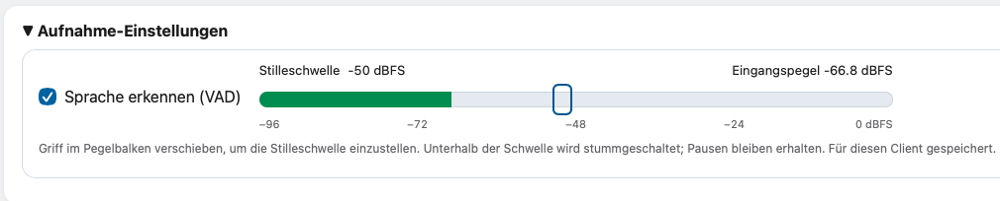

# Aufnahme, Prüfung und Übernahme

[Zur Übersicht](../README.md) · [T2med einrichten](t2med.md)

Diese Hinweise beschreiben den gemeinsamen Installerstand; die öffentlichen
Pakete folgen nach Freigabe. Ältere Quellcode-Ausgaben können abweichen.

1. Patientenakte in T2med öffnen und KienzleDoku über den eingerichteten Knopf starten.
2. **Patientennamen prüfen.** Die Mikrofonaufnahme beginnt beim Aufruf.
3. Aufnahme stoppen. Transkript und Dokumentationsentwurf vollständig prüfen und bearbeiten.
4. Bei Bedarf **Aufnahme fortsetzen** oder das bearbeitete Sprechertranskript **neu zusammenfassen**.
5. Erst **In T2med übernehmen** schreibt die geprüfte Dokumentation in die Patientenakte.

Der Installer legt die Dokumentationsfelder fest: Anamnese, Befund, EKG,
Sonografie, Therapie, Prozedere und Notiz. Alternativ ist ein gemeinsamer
Freitext-Eintrag möglich. Ohne passende Gesprächsinformation bleibt ein Feld leer.

**Fenster schließen und verwerfen** verwirft die offene Arbeit. Aufnahme,
Transkript und Entwurf bleiben nur im Arbeitsspeicher; es gibt in diesem
Installerstand keine lokale Wiederherstellung. Nur technische Einstellungen
werden gespeichert. Ein zweiter Patientenaufruf ersetzt ein offenes Fenster nicht.

Bei unklarem Ausgang einer Übernahme zuerst in T2med prüfen, ob die Dokumentation
bereits vorhanden ist. Eine möglicherweise erfolgreiche Übertragung niemals
ungeprüft wiederholen.

## Mikrofon und Pegel

Während einer Aufnahme **Aufnahme-Einstellungen** öffnen. Der Eingangspegel zeigt
das ungefilterte Mikrofonsignal; ein Ausschlag kann daher auch unterhalb der
Stilleschwelle sichtbar sein.

Bitte die Stilleschwelle so einstellen, dass auch leise Sprache erkannt wird.
Eine zu empfindliche Einstellung kann Halluzinationen bei der Texterkennung
begünstigen – also Text, der gar nicht gesprochen wurde. Die Schwelle soll über
dem Hintergrundpegel und unter leiser Sprache liegen; −60 dBFS ist empfindlicher
als −40 dBFS. VAD prüft zusätzlich auf Sprache. Die Stilleschwelle bleibt auch
bei ausgeschaltetem VAD wirksam.

Vorgabe bei Erstinstallation: VAD an, −50 dBFS. Änderungen gelten für die kommende
Verarbeitung und werden für diesen Client gespeichert. Die Mikrofonlautstärke
wird dadurch nicht verändert. Kurze Randbereiche schützen Wortanfänge und -enden;
Pausen bleiben zeitlich erhalten.

## Längere Gespräche

Ein Aufnahmeabschnitt ist auf zwei Stunden begrenzt und wird dann abgeschlossen.
Anschließend kann die Aufnahme fortgesetzt werden. Der Speicherbedarf hängt von
Länge, Hardware und Modellen ab; eine zweistündige Verarbeitung wurde nicht auf
jeder Plattform praktisch geprüft. Erkannter Text bleibt bei fehlgeschlagener
Sprecherzuordnung im offenen Fenster bearbeitbar.

Beim Fortsetzen erscheint eine Abschnittsmarkierung; Sprecherkennungen können
sich zwischen Abschnitten unterscheiden. Die Markierung wird nicht als
medizinischer Befund übernommen.

[Erstvorstellung KienzleDoku](https://www.youtube.com/watch?v=6l1U047NSwg)
· [Technik und Fehlerhilfe](technik.md)
