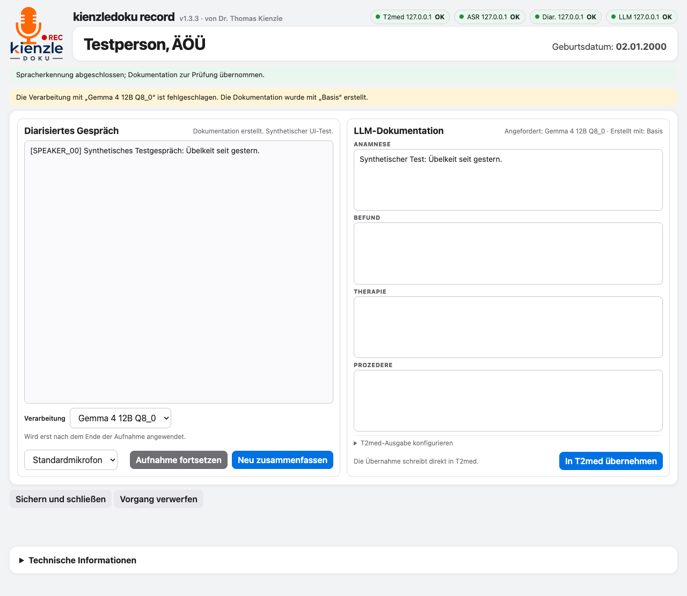

# Commander und Record/Connect zusammengeführt

Stand: 10.11.2026. Dieser Entwicklungsstand verbindet die bestehende Oberfläche
von Record 1.3.3 mit der Commander-Schnittstelle. Die bereits vorhandenen lokalen
Record-/Connect-Änderungen sind Bestandteil der Zusammenführung.

## Zuständigkeiten

```text
Record ── Audio, Sprechertrennung, Dokumentation ── Commander ── KI-Worker
Record ── FHIR ── Connect ── T2med
```

Commander verwaltet Aufträge und Modellwechsel. Connect bleibt Starter und
FHIR-Vermittler mit unveränderter Key-Ersetzung; dort wurde keine KI-Steuerung
ergänzt. Der ausdrücklich gewählte FHIR-Direktbetrieb bleibt ebenfalls möglich.

Im Commander-Betrieb gehen alle drei KI-Auftragsarten an dieselbe Adresse.
Die Modellauswahl stammt aus dem Serverkatalog, einschließlich der Modelle des
Windows-Installers. Ein Auswahlwechsel fordert noch keinen Modellwechsel an.
Erst nach tatsächlichem Aufnahmeende und Abschluss aller ASR-Blöcke folgen
Sprechertrennung und Dokumentation. Eine erneute Zusammenfassung verwendet
ebenfalls den Commander und das vollständige bearbeitete Sprechertranskript.

## Herkunft und unveränderte Bestandteile

Die 13 Programm-/Promptdateien unter `/opt/kienzledoku-commander` auf
`10.0.83.140` wurden per SSH ausschließlich gelesen und per SHA-256 mit der
Commander-Übergabe vom 09.11.2026 verglichen. Alle stimmen überein. Der Dienst
war bei dieser Prüfung `inactive`, Port 8185 nahm keine Verbindung an.
Es erfolgte weder eine Aktivierung noch ein Deployment.

Das Serverpaket `kienzledoku_commander/`, der Dokumentparser und der Prompt
bleiben auf diesem Stand. Der Client-Transport wurde für Record/Connect,
Windows-Zugangsdaten und den erweiterten Serverkatalog angepasst.

Unter `server-windows/` liegt der **unveränderte Server-Installer 1.12**:
266 Dateien aus der Übergabe, ohne Python-Bytecode-Caches. Quellen, vorhandene
Builds und historische Nachweise wurden bytegleich übernommen. EXE und ZIP
stimmen mit ihren SHA-256-Dateien überein; die EXE im ZIP ist identisch mit dem
einzelnen Download. Es gab keinen Neubau und keine Versionsänderung.

Der Benutzer hat den erfolgreichen Windows-Betrieb am 10.11.2026 bestätigt.
Diese Rückmeldung ergänzt die historischen Nachweise; sie wurde nicht als ein
neu durch den Agenten ausgeführter Windows-Test eingetragen.

Details und Prüfsummen: [Herkunftsnachweis](commander-source-provenance-2026-11-10.json).
Modelle, Hersteller-Key und Benchmark-Ergebnisse wurden nicht geändert.

## Einrichtung des Clients

Neue Konfigurationen aktivieren Commander mit `http://127.0.0.1:8185`.
In den grafischen Einstellungen werden die tatsächliche Commander-Adresse und
der Zugang eingerichtet. Bei einem entfernten Server dessen Adresse verwenden;
Client und Server können auch auf demselben Rechner laufen.

Der technische TOML-Abschnitt enthält `enabled`, `url`, `token_env`,
`token_file`, `request_timeout` und `default_quality`. Der Tokenwert selbst
wird separat gespeichert: unter Windows mit DPAPI, unter macOS/Linux in einer
privaten Datei. Ein leeres Zugangsfeld behält den vorhandenen Zugang.

Vorhandene TOML-/JSON-Konfigurationen ohne Commander bleiben zunächst bei ihren
bisherigen Dienstadressen. Ein vorhandener JSON-Commander-Block wird übernommen.
Commander lässt sich anschließend gezielt aktivieren. Eine nicht erreichbare
Commander-Verbindung führt nicht zu einem automatischen Wechsel auf alte Dienste.

## Prüfungen

Auf macOS mit CPython 3.12.14 geprüft:

- Gesamtsuite: **100 Tests bestanden**, einschließlich des frisch aus den
  unveränderten Go-Quellen gebauten Connect gegen einen lokalen HTTPS-Testserver.
- Ergänzter HTTP-Test für temporäre Tokenprüfung und Speicherung: **1 Test
  bestanden**. Zusammen 101 erfolgreiche Python-Tests des Integrationsstands.
- Der neue Client spricht im Vertragstest die unveränderte Windows-/WSL-API
  an: alle sechs Katalogmodelle, Serverstandard und Extraktion geprüft.
- Die Commander-Tests decken außerdem Queue, Finalisierung, Fallbacks und
  Wiederherstellung der ASR-Bereitschaft mit simulierten Modellen ab.
- Go-Tests, Record-Selbsttest, Linux-Client-Installer-Selbsttest, statische
  Linux-/macOS-KI-Installerprüfungen und Shellsyntax erfolgreich.
- Syntax der geänderten Clientmodule mit Python 3.9 kompatibel.
- Drei Chrome-Prüfungen erfolgreich: Einstellungen/Installation, Aufnahme mit
  Live-Umlauten und verzögertem Patientenladen sowie Commander-Modellauswahl
  mit unveränderter Auswahl beim Statusabruf und sichtbaren Ergebnis-Metadaten.
- Unverändertes Windows-Serverpaket: **92 Tests ausgeführt, davon 91 bestanden
  und ein Linux-/glibc-spezifischer Test unter macOS ausdrücklich übersprungen**.
- Git-Diff ohne neue Leerraumfehler; Originalpakete und Serverquellen erneut
  gegen die Übergabe verglichen.

Tests verwenden synthetische Daten und simulierte Modellarbeit. Sie ersetzen
keine Ausführung der neuen Client-Integration mit echtem Mikrofon, T2med und GPU.
Ein neuer nativer Windows-Client-Build wurde auf diesem Mac nicht ausgeführt.

Der Windows-Installer wurde funktional nicht verändert. Seine Linux-/WSL-
Komponenten können auf dem Mac bis auf den glibc-spezifischen Speichertest
geprüft werden; dieser Test wird dort ausdrücklich übersprungen.



Synthetische UI-Prüfung mit simuliertem Modellresultat und im Testkatalog
ausdrücklich definiertem Fallback; die produktiven Modellregeln bleiben unverändert.
