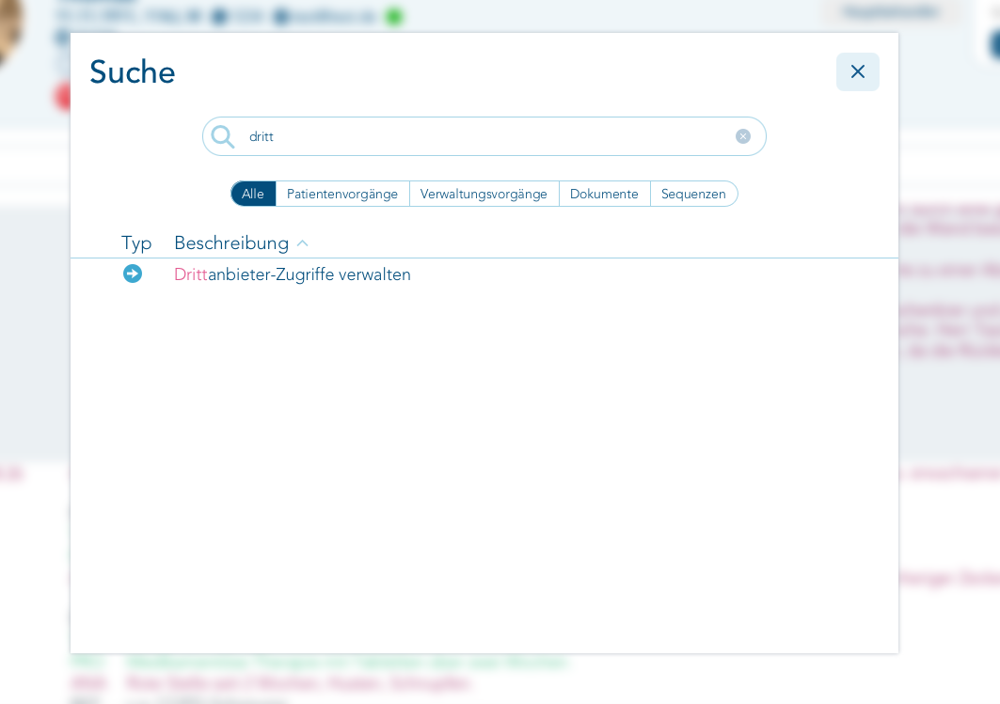
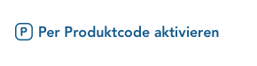
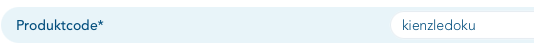
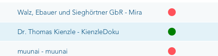
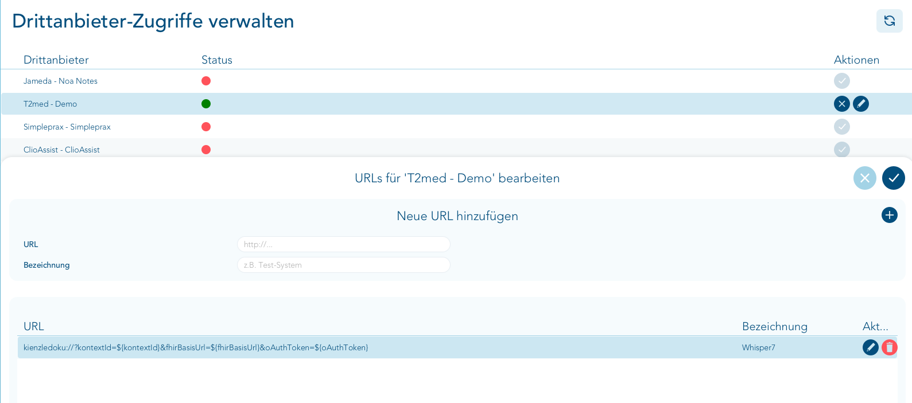

# T2med einrichten

[Zur Übersicht](../README.md) · [Installation](installation.md)

Diese Anleitung gehört zum gemeinsamen Installerstand. Die öffentlichen Pakete
werden nach Freigabe ergänzt; die älteren Quellcode-Installer sind separat im
[Archiv](archiv/direktbetrieb.md) beschrieben.


Nach der Client-Installation wird kienzledoku record in T2med als
Drittanbieter-URL hinterlegt. Die Darstellung kann je nach T2med-Version
geringfügig abweichen.

1. In der T2med-Suche `dritt` eingeben und
   **Drittanbieter-Zugriffe verwalten** öffnen.

   

2. **Per Produktcode aktivieren** wählen.

   

3. In das Feld **Produktcode** genau `kienzledoku` eingeben und die Aktivierung
   bestätigen.

   

4. In der Liste erscheint **Dr. Thomas Kienzle - KienzleDoku** mit einem
   **grünen Statuspunkt**. Daran ist die erfolgreiche Aktivierung erkennbar.

   

5. Den Eintrag für die URL-Einrichtung über das Stiftsymbol bearbeiten.
   Für den gemeinsamen Installer den zuvor aktivierten Eintrag **KienzleDoku** verwenden.
6. Eine neue URL hinzufügen. Für den Aufruf über **Connect** diese vollständige
   Zeile kopieren und unverändert einfügen:

   ```text
   kienzledoku://record?kontextId=${kontextId}&fhirBasisUrl=${fhirBasisUrl}&oAuthToken=${oAuthToken}
   ```

7. Als Bezeichnung **kienzledoku record** eintragen.
8. Den URL-Eintrag und anschließend den Drittanbieterzugriff jeweils mit dem
   Häkchen speichern. Der Eintrag sollte danach als aktiv angezeigt werden.

   

   Der Screenshot zeigt einen älteren Eintrag mit der Bezeichnung `Whisper7`
   und einer alten URL. Bitte die passende aktuelle URL aus Schritt 6 verwenden.

9. Einen **Knopf in der Menüleiste einrichten** und ihm den soeben angelegten
   Drittanbieter-Eintrag **kienzledoku record** zuweisen. Damit wird Record für
   den aktuell geöffneten Patienten gestartet.

T2med ersetzt die Platzhalter selbst. Hinweise zu älteren Einträgen und zum
Direktbetrieb stehen im [Archiv](archiv/direktbetrieb.md).
