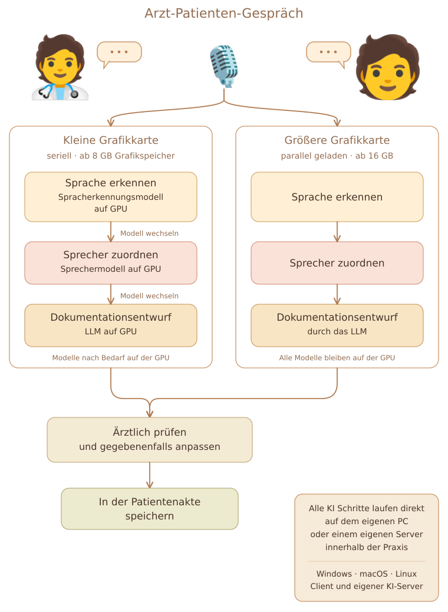

# Technik, Konfiguration und Fehlerhilfe

[Zur Übersicht](../README.md) · [Installation](installation.md)

Diese Seite beschreibt den aktuellen gemeinsamen Installerstand, dessen
öffentliche Bereitstellung noch aussteht. Der bisherige Quellcode auf `main`
kann davon abweichen. Die [archivierte README](archiv/readme-vor-2026-11-15.md)
bewahrt den bisherigen ausführlichen Dokumentationsstand.

## Aufgaben der Komponenten

- **Record:** Mikrofonaufnahme, Transkript, editierbarer Dokumentationsentwurf und bewusste Übernahme in T2med.
- **Commander:** gemeinsamer KI-Endpunkt für Spracherkennung, optionale Sprecherzuordnung und LLM; Warteschlange und Modellwechsel.
- **Connect:** T2med-Anbindung und URL-Aufruf. Connect steuert keine KI-Modelle.

Client und Server können auf demselben Rechner oder getrennt im Praxisnetz
laufen. Im aktuellen Installerstand verwendet der Client immer Commander,
normalerweise `http://SERVER:8185`. Ein eigener LLM-Commander auf einem zweiten
Rechner ist möglich; dessen Modelle, Felder und Prompt sind dann maßgeblich.
Es erfolgt bei Ausfall kein stiller Wechsel auf ein anderes LLM.

## Modellbetrieb

**Seriell:** Modelle werden nach Bedarf geladen und vor dem nächsten Schritt
entladen. Im verschärft seriellen Modus lädt Whisper mit dem ersten Audioblock,
bleibt zwischen Audioblöcken geladen und wird vor Sprecherzuordnung bzw. LLM
entladen. Nach der Verarbeitung wird es erst beim nächsten Audioblock nachgeladen.
Record puffert währenddessen im Arbeitsspeicher.

**Parallel geladen:** Bei ausreichendem Speicher können Modelle gleichzeitig
resident bleiben. Das bedeutet nicht, dass die Verarbeitungsschritte eines
Gesprächs gleichzeitig ablaufen.

Die Sprecherzuordnung ist unabhängig wählbar: immer geladen, zusammen mit
Whisper oder seriell nach Whisper und vor dem LLM. Hardware- und Modellgrenzen
zeigt der Installer. Messwerte auf einer Plattform sind keine Speicherzusage
für beliebig lange Gespräche auf anderen Systemen.

[Benchmarks und Modelle](https://kienzledoku.de/benchmarks.html)

## Einstellungen

Modelle, Stufenzuordnung, Prompt und Dokumentationsfelder gehören zum Commander.
Der Client erhält die verfügbaren Stufen **Basis**, **Gründlich** und
**Sehr gründlich**. Bei nur einer verfügbaren Stufe entfällt die Auswahl.
Der aktive Prompt ist unter **Technische Informationen** einsehbar.

Die Programmverknüpfung ohne Patientenaufruf öffnet die Clienteinstellungen.
Hier werden T2med-Basis, Commander-Adresse, Zertifikatsoption und Mikrofon gewählt.

| Plattform | Clientkonfiguration |
| --- | --- |
| Windows | `%LOCALAPPDATA%\kienzledoku record\config.toml` |
| macOS | `~/Library/Application Support/Kienzledoku/config.toml` |
| Linux | `$XDG_CONFIG_HOME/kienzledoku/config.toml`, sonst `~/.config/kienzledoku/config.toml` |

Die VAD- und Stilleschwellenwerte bleiben pro Client erhalten. VAD läuft lokal
auf der CPU. Das Pegel-Gate verändert nur die ASR-Arbeitskopie und erhält die
Zeitachse; das Originalaudio für die Sprecherzuordnung bleibt im RAM.

## Wenn etwas nicht funktioniert

- **Kein Fenster beim Patientenaufruf:** T2med-URL und Commander-Erreichbarkeit prüfen. Während eines Serverupdates ist Commander vorübergehend nicht erreichbar. Beim beobachteten Mac-Stand kann dann die Fehlermeldung ausbleiben; nach abgeschlossenem Serverstart erneut aufrufen.
- **KI-Dienst nicht bereit:** Commander-Adresse, Netzwerkzugang und Serverstatus prüfen. „Wird geladen“ oder „Standby“ kann bei seriellem Betrieb normal sein.
- **VAD-Laufzeitfehler unter Windows:** Im neuen Setup werden benötigte Microsoft-C++-Laufzeiten automatisch geprüft und bei Bedarf eingerichtet. Vollständige Fehlermeldung und genaue Paketversion für die Diagnose verwenden.
- **Leise Wörter fehlen oder erfundener Text erscheint:** Mikrofon und Stilleschwelle anhand der [Pegelhinweise](bedienung.md#mikrofon-und-pegel) einstellen, anschließend mit einem Testgespräch prüfen.
- **Unklarer Schreibausgang:** Zuerst T2med kontrollieren, Übertragung nicht automatisch wiederholen.

## Technische Grenzen

Audio, Transkript und Entwurf werden im aktuellen Installerstand nicht auf
Datenträger geschrieben. Beim Schließen oder Absturz endet die offene Arbeit.
Commander und Worker akzeptieren bis zu 256 MiB Audio je Anfrage; die begrenzte
Commander-Warteschlange hat 512 MiB Nutzlastbudget. Diese Grenzen ersetzen keine
praktische Speicherprüfung auf der eingesetzten Hardware.

Record akzeptiert das konfigurierte HTTPS-FHIR-Ziel samt Host, Port und
Basispfad. TLS wird standardmäßig geprüft. Commander-Verbindungen verwenden
gegenwärtig HTTP im kontrollierten Praxisnetz; Zugangstoken sind optional.
Keine öffentlichen Internetfreigaben aus dieser Beschreibung ableiten.

OAuth, API-Keys und Patientendaten gehören nicht in Fehlerberichte. Die fertigen
Installer verwenden den privat kompilierten Hersteller-Key; öffentliche
Quellcode-Builds ohne privaten Build-Eingang verwenden den Demo-Key.
[Sicherheitsmeldungen](../SECURITY.md)

## Entwicklung

Der bisherige Quellcode und seine Tests bleiben erhalten. Tests passend zum
jeweils ausgecheckten Stand ausführen; diese Dokumentationsänderung veröffentlicht
keinen neuen Programmstand. Hinweise: [Beitragen](../CONTRIBUTING.md),
[Release-Checkliste](../RELEASE-CHECKLIST.md),
[Commander-Integrationsnachweis](commander-integration-2026-11-10.md).
