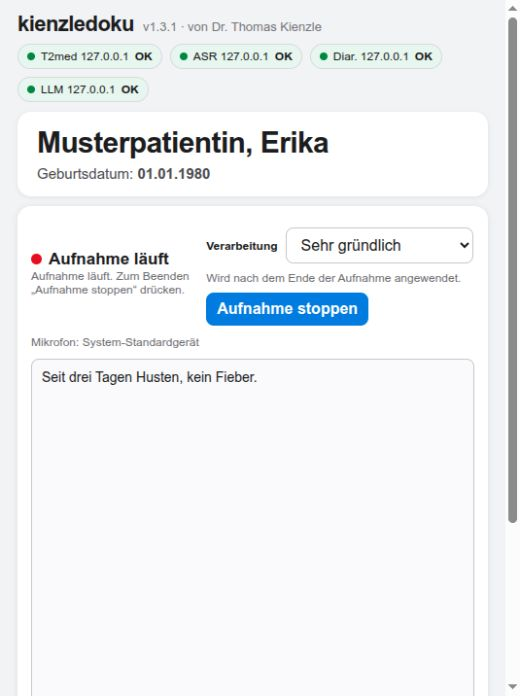

# kienzledoku-commander

**Übernahmestand 10.11.2026:** Die Serverquellen wurden mit der installierten
Version auf dem bisherigen Linux-Server per SHA-256 abgeglichen. Die gemeinsame
Record-/Connect-Oberfläche verwendet jetzt diese API und den erweiterten Katalog
des Windows-Servers. Herkunft und aktuelle Prüfungen stehen im
[Integrationsnachweis](../../docs/commander-integration-2026-11-10.md).
Die folgenden Profil- und Installationsangaben beschreiben den übernommenen
Linux-Serverstand; die früheren Screenshots zeigen dessen damaligen Client.

Der Commander nimmt Verarbeitungsanfragen an, stellt die benötigte
Modellkombination bereit und stellt nach den LLM-Aufträgen sofort die
ASR-Bereitschaft wieder her. Er läuft als eigener Dienst auf dem bestehenden
Ubuntu/NVIDIA-Server. Der Klick auf „Fertig“ ist daran nicht beteiligt.

Diese Fassung enthält die Server-Schnittstelle, Worker-Hooks, den
Installations-/Rückbauweg und die optionale Anbindung der Aufnahmeoberfläche.
Sie ist mit kontrollierten lokalen Testdiensten einschließlich WAV-Replay
getestet. Die Aktivierung auf der RTX 3090 ist ein eigener Integrationsschritt.
Die Entwicklung verändert keine laufenden Serverdienste.

## Profile und Standard

| VRAM | Basis (`basis`) | Gründlich (`gruendlich`) | Sehr gründlich (`sehr_gruendlich`) |
| --- | --- | --- | --- |
| 8 GiB | 9B Q4_K_M, seriell, Kontext 32.768 | nicht erlaubt | nicht erlaubt |
| 16 GiB | 9B Q4_K_M, persistent, Kontext 32.768 | 9B Q6_K, seriell, Kontext 87.552 | nicht erlaubt |
| 24 GiB | **nicht erlaubt** | 9B Q6_K, persistent, Gesamtkontext 262.144 / 3 Slots | 27B UD-Q4_K_M, seriell, Kontext 262.144 |

Q4/Q6 verwenden KV q8_0; 27B verwendet KV q4_0. Der 24-GiB-Q6-Kontext
beträgt nach Aufrundung durch den geprüften llama.cpp-Build 87.552 Tokens pro Slot.
Das 27B-Modell ist das im Benchmark geprüfte
Qwen3.8-27B-UD-Q4_K_M; es wird hier nicht heruntergeladen oder konvertiert.

`policy.default_quality = "auto"` wählt Basis auf 8/16 GiB und Gründlich auf
24 GiB. Eine erlaubte höhere Standardstufe kann explizit gesetzt werden.
Bei einem seriellen Standard bleiben im Ausgangszustand ASR und (ab 16 GiB)
pyannote bereit, während das LLM erst für einen Auftrag geladen wird.

Persistent bedeutet, dass Whisper, pyannote und das betreffende LLM auf der
GPU bleiben. Gleichzeitige ASR-, Diarisierungs- und LLM-Arbeit ist erlaubt.
Seriell bedeutet, dass Whisper **und** pyannote vor dem LLM in den RAM
verschoben werden. Auf 8 GiB wird Whisper außerdem während der Diarisierung
geparkt. Die vorhandenen Worker-Prozesse und Modellobjekte bleiben erhalten.
Whisper parkt sowohl CTranslate2 (`to_cpu=True`, Rückkehr mit `keep_cache=True`)
als auch das zusätzliche Torch-Modell; eine zweite Whisper-Instanz entsteht nicht.

## Queue und Fehler

Für den beauftragenden Arbeitsplatz ist die Reihenfolge verbindlich:
**Mikrofon stoppen → letzte Audioblöcke vollständig transkribieren → Diarisierung
→ LLM-Verarbeitung.** Die Qualitätsauswahl merkt nur den Wunsch und sendet keinen
Umladeauftrag. Auch der Klick auf „Aufnahme stoppen“ selbst genügt noch nicht:
Der Aufnahmeprozess muss das tatsächliche Ende und den Abschluss der ASR-Queue
bestätigen. Erst danach darf dieser Client eine ressourcenwechselnde Verarbeitung
anfordern. Ein vollständiges Sprechertranskript kann anschließend mit einer
anderen Qualität erneut verarbeitet werden; während der Aufnahme ist diese
Aktion gesperrt.

Der Client bestätigt diesen Zustand dem Commander über
`recording_finalized: true` bei LLM-JSON-Anfragen bzw. den Header
`X-Kienzledoku-Recording-Finalized: true` bei der Diarisierung. Der Header ist
auch für `/v1/chat/completions` zulässig. Fehlende oder falsche Bestätigung
ergibt `409 recording_not_finalized`, bevor der Auftrag die Umschaltqueue
erreicht. Der Server vertraut hierbei der Bestätigung des Clients; er kann
das entfernte Mikrofon nicht selbst überprüfen.

Andere Arbeitsplätze bleiben unabhängig und dürfen weiter aufnehmen. Ihre
Final-Block-ASR-Anfragen benötigen diese Bestätigung nicht und warten während
einer GPU-Pause in der Queue. Es gibt keine globale Aufnahmesperre.

Bereits wartende Aufträge für das geladene LLM werden vor dem Zurückladen
abgearbeitet. Es gibt keine zusätzliche Wartezeit für mögliche spätere Anfragen.
Kommt eine Anfrage während der Rückkehr, wird sie eingereiht und löst anschließend
bei Bedarf den nächsten Modellwechsel aus. Ein Ergebnis wird sofort ausgeliefert;
die Wiederherstellung der ASR läuft danach im Hintergrund.

Ein Modell wird erst verschoben, wenn seine aktiven Zugriffe beendet sind.
Neue Zugriffe auf dieses Modell warten während des Wechsels. Das ist keine
Sperre gegen gleichzeitige GPU-Last durch die drei Dienste. Ein direkt am
Whisper-Worker verbundener Streaming-WebSocket behält sein Modell allerdings
bis zum Ende der Sitzung. Für serielle Kienzledoku-Verarbeitung müssen die
Final-Block-Anfragen über den Commander laufen.

Bei einem Lade-, Generierungs- oder Ausgabeformatfehler erfolgt genau ein
erlaubter Rückfall: auf 24 GiB Sehr gründlich → Gründlich; auf 16 GiB Gründlich
→ Basis. Auf 24 GiB folgt **niemals** Basis. Scheitert auch die Ersatzstufe,
kommt eine Fehlermeldung. Beschäftigte oder gerade umladende Worker lösen
keinen Rückfall aus. Die Dokumentation muss vollständig aus exakt vier
Textfeldern bestehen; unvollständige, abgeschnittene oder doppelte Felder
gelten als Fehler. Der Ersatzversuch erhält dieselbe ursprüngliche Eingabe.

Audioaufnahme und Transport sind getrennt: Während der Commander ASR-Anfragen
zurückhält, kann der Client weiter aufzeichnen. Der Client muss ausstehende
Blöcke bis zum erfolgreichen Ergebnis aufbewahren. Der Commander legt keine
Audiodateien oder dauerhafte Queue an. Bei Neustart oder endgültigem Fehler
muss der Client ausstehende Blöcke erneut senden.

## HTTP-Vertrag

Standardadresse: `http://127.0.0.1:8185`. Bei gesetztem Token erfordern alle
Endpunkte außer `/health` den Header `Authorization: Bearer <Token>`.

| Methode / Pfad | Zweck |
| --- | --- |
| `GET /health` | Nach initialer ASR-Bereitschaft `200`, auch während geplanter GPU-Pausen; `asr_ready` zeigt die tatsächliche Modellbereitschaft. Beim Start `503`. |
| `GET /v1/runtime/status` | Profil, geladene Rollen, Umschaltphase, Queue-/Aktivzahlen, Fehlercode; ohne Inhalte. |
| `GET /v1/runtime/profiles` | Erlaubte Qualitätsstufen, Standard zuerst, Kontext/Slots, Rückfall und Betriebsweise. |
| `GET /v1/models` | Gleiche Liste im OpenAI-kompatiblen Format. |
| `POST /v1/documentation/extract` | Transkript und Qualitätswunsch; löst die Modellumschaltung aus. |
| `POST /v1/chat/completions` | Kompatibler Text-Endpunkt für bestehende Kienzledoku-Clients, ohne Streaming/Tools. `model` ist die Qualitäts-ID. |
| `POST /v1/asr/final-block` | Bestehender Multipart-Vertrag (`file`, optional `language`), bis 64 MiB. |
| `POST /v1/diarize` | WAV-Body, optional numerische `num_speakers`, `min_speakers`, `max_speakers`. |

Extraktionsanfrage (synthetisch):

```json
{
  "request_id": "aufnahme-123-extraktion-1",
  "recording_finalized": true,
  "quality": "sehr_gruendlich",
  "transcript": "ARZT: Seit wann besteht der Husten? PATIENT: Seit drei Tagen."
}
```

Antwort bei erfolgreichem Rückfall (verkürzt):

```json
{
  "documentation": {"anamnese": "Seit drei Tagen Husten.", "befund": "", "therapie": "", "prozedere": ""},
  "commander": {
    "request_id": "aufnahme-123-extraktion-1",
    "requested_quality": "sehr_gruendlich",
    "used_quality": "gruendlich",
    "fallback_used": true,
    "notice": "Die angeforderte Verarbeitung ist fehlgeschlagen. Die Dokumentation wurde mit Gründlich erstellt."
  }
}
```

`quality` darf entfallen und verwendet dann den konfigurierten Standard.
`recording_finalized` ist verbindlich; vorzeitig eingereichte LLM-/Diarisierungs-
Aufträge werden abgewiesen. Die
OpenAI-Antwort enthält die Metadaten außerhalb von `choices[0].message.content`;
der Vier-Felder-Vertrag bleibt erhalten. Clients sollen `commander.notice`
anzeigen. Die aktualisierte Clientfassung zeigt die Qualitätsauswahl im
Aufnahmefeld, die tatsächlich verwendete Stufe an der Dokumentation und eine
separate gelbe Meldung bei einem Rückfall. Ohne Commander-Konfiguration bleibt
der bisherige Betrieb mit drei residenten Diensten erhalten.

`request_id` oder `Idempotency-Key` (1–96 Zeichen, Buchstaben/Ziffern/`_`/`-`)
dedupliziert dieselbe Anfrage. Wiederholung mit anderem Inhalt ergibt `409`.
Ergebnisse bleiben höchstens fünf Minuten und bis zu 256 Anfragen im RAM;
nach Verdrängung/Ablauf oder Neustart kann dieselbe ID erneut verarbeitet werden.
Rohes Audio und Eingabetranskripte werden nach Abschluss aus dem Job entfernt.
Abgebrochene HTTP-Verbindungen brechen laufende Verarbeitung und Rückkehr nicht ab.

Fehler: `400` ungültige/unerlaubte Anfrage, `401` Token fehlt, `409` ID-Konflikt,
`429` volle Queue, `502` endgültiger Backendfehler, `503` nicht verfügbar oder
Queue-Zeitgrenze. Fehler enthalten einen maschinenlesbaren `error.code` und eine
deutsche Meldung, keine Rohantwort des Backends. Standardgrenzen: 128 wartende
Aufträge, 256 MiB aktive/wartende Nutzdaten, 900 s bis zum Start bzw. Wiederantritt
einer wartenden Anfrage, 600 s pro Backend-Aufruf. Wiederholen nach einem
endgültigen Fehler benötigt eine **neue** Anfrage-ID; dieselbe ID liefert den
bereits gespeicherten Fehler.

## Installation auf dem geprüften Linux-Server

Voraussetzung: Python 3.12+, vorhandene CUDA-Worker und llama-server. Die Diarisierung darf als ASR-Benutzer oder als `root` laufen. Für einen
root-Worker wird ein eigener Socket in einem root-eigenen Verzeichnis (0750)
mit Socket-Zugriff (0660) für die Commander-Gruppe eingerichtet. Die Gruppe
kann das Verzeichnis nicht verändern; der private ASR-Socket bleibt 0700/0600. Die Hooks passen ausschließlich
zu den geprüften Originaldateien (SHA-256-Schranke in `patch_workers.py`); bei
anderen Worker-Versionen wird abgebrochen. Beide Dateien werden vor der ersten
Änderung geprüft und gesichert. Ein Schreibfehler rollt die Änderungen zurück.

Im Repository:

```bash
sudo ./server-linux/commander/install.sh --check
sudo ./server-linux/commander/install.sh --install
```

`--check` liest nur. `--install` legt die Programmdateien unter
`/opt/kienzledoku-commander`, die Konfiguration unter
`/etc/kienzledoku-commander/commander.toml` sowie gesicherte Worker-Hooks und
systemd-Drop-ins an. Es startet oder beendet keinen laufenden Dienst. Die
Hooks wirken beim nächsten Worker-Neustart. Vorhandene Konfiguration bleibt
erhalten. Sicherungen liegen unter `/var/lib/kienzledoku-commander/worker-backup`.

Vor Aktivierung die Modellpfade prüfen, insbesondere die dauerhafte 27B-Datei.
Es werden keine Modelle heruntergeladen. Fehlende größere Modelle führen bei
einer Anfrage zum dokumentierten Rückfall. `vram_gib` lässt sich explizit setzen;
auf der 3090 erkennt `auto` 24 GiB. Genau eine GPU wird unterstützt; deren Index
muss zu den bestehenden ASR-/pyannote-Workern passen.

LAN-Zugriff erst nach Einrichtung des Tokens aktivieren. Beispielsweise ein
Token erzeugen (wird ausschließlich in die root-lesbare Datei geschrieben):

```bash
sudo python3 - <<'PY'
import os, secrets
path = '/etc/kienzledoku-commander/token.env'
fd = os.open(path, os.O_WRONLY | os.O_CREAT | os.O_EXCL, 0o600)
with os.fdopen(fd, 'w') as f:
    f.write('KIENZLEDOKU_COMMANDER_TOKEN=' + secrets.token_urlsafe(32) + '\n')
PY
```

Danach `server.host = "0.0.0.0"` setzen. `token.env` akzeptiert unquotierte
`KEY=value`-Zeilen für `KIENZLEDOKU_COMMANDER_TOKEN` und optional
`KIENZLEDOKU_COMMANDER_ASR_TOKEN` (falls der vorhandene Worker ein Token verlangt).
Ohne Token verweigert der Commander einen LAN-Bind. HTTP nur im vertrauenswürdigen
Praxisnetz/VPN verwenden, andernfalls TLS vorlagern. Die Firewall wird nicht
automatisch erweitert. Interne Backend-Adressen bleiben ausschließlich lokal.

Bewusste Aktivierung:

```bash
sudo ./server-linux/commander/install.sh --activate
```

Hierbei wird der bisherige LLM-Dienst gestoppt und ASR/pyannote einmal neu
gestartet, um die Hooks zu laden. Danach verwaltet der Commander einen eigenen
llama-server auf dem internen Port 8086. Der alte LLM-Dienst und der Commander
haben einen systemd-Konflikt, damit keine zweite unverwaltete LLM-Instanz läuft.
Kokoro/TTS wird nicht verwaltet oder entladen. Bei fehlgeschlagener Aktivierung
werden die Originaldateien und vorherigen Dienstzustände wiederhergestellt.

Für den Kienzledoku-Client die unten beschriebene Commander-Konfiguration
aktivieren. Legacy-Verbraucher am alten LLM-Port 8080 müssen vor Aktivierung
ebenfalls berücksichtigt werden; der Installer konfiguriert keine Telefonie-
Agents oder Kapazitäts-Publisher um. Für normale Modellwechsel danach sind
keine Worker-Neustarts erforderlich.

## Lokalen Client für einen Test anbinden

Die aktualisierte Clientfassung benötigt zusätzlich
`kienzledoku_commander_client.py`; Linux- und macOS-Installer installieren diese
Datei mit. Eine bestehende `commander`-Konfiguration bleibt beim erneuten
Clientinstallieren erhalten. Die installierte Kopie muss ebenfalls aktualisiert
werden; allein Änderungen an einer Git-Arbeitskopie ändern eine aus T2med
gestartete Installation noch nicht.

In der bestehenden `config.json` einen zusätzlichen Block ergänzen; `t2med`
und die bisherigen `services` behalten. Beispiel für die RTX 3090:

```json
"commander": {
  "enabled": true,
  "url": "http://10.0.83.140:8185",
  "token_file": "/home/thomas/.config/kienzledoku/commander.token",
  "default_quality": "auto",
  "request_timeout": 2400
}
```

Die Token-Datei enthält nur das Commander-Bearer-Token, gehört dem aktuellen
Benutzer und hat Modus `0600`. Sie ermöglicht den Start aus T2med ohne
Abhängigkeit von einer Terminal-Umgebung. Alternativ kann `token_env`
(Standard `KIENZLEDOKU_COMMANDER_TOKEN`) verwendet werden; ein dort gesetzter
Wert hat Vorrang. Tokens werden weder im HTML noch in Prozessargumenten oder
Statusmeldungen ausgegeben. Unter macOS den absoluten Pfad zur privaten
Token-Datei des dortigen Benutzers verwenden; `~` wird expandiert.

Der aktivierte Block übernimmt alle drei KI-Dienstziele. Die Qualitätsoptionen
kommen vom Server; auf 24 GiB erscheinen nur Gründlich und Sehr gründlich.
„Standard“ verwendet die Servervorgabe. Ein expliziter lokaler Standard lässt
sich über `default_quality` setzen. Während einer Aufnahme kann die Auswahl
für die spätere Verarbeitung geändert werden, ohne Modelle zu bewegen.

Der Client wartet bei ASR-/Diarisierungsanfragen entsprechend lange auf die
Queue. Die Mikrofonaufnahme läuft dabei unabhängig weiter. Für die eigene
LLM-Anforderung wird erst nach tatsächlichem Aufnahmeende und vollständiger
ASR finalisiert; das LLM läuft einmal auf dem gesamten Sprechertranskript,
auch bei fortgesetzten Aufnahmen. Bei erneutem Zusammenfassen wird eine neue
Anfrage-ID erzeugt. Der Rückfallhinweis bleibt sichtbar, wenn das Ergebnis
zur Prüfung in die vier Dokumentationsfelder übernommen wurde.

Zum Zurückschalten `enabled` auf `false` setzen und eine neue Kienzledoku-Sitzung
öffnen. Dann gelten wieder die gespeicherten drei Dienstadressen. Der jeweilige
Serverbetrieb muss dazu passen. Vor echten Gesprächen mit einem synthetischen
Gespräch prüfen, dass Profilabruf, Aufnahme, Final-ASR, Diarisierung, gewählte
Qualität und ASR-Rückkehr funktionieren. Diese Version ist noch nicht auf dem
produktiven 3090-Server aktiviert.

UI-Prüfung mit ausschließlich synthetischen Daten:



[Ergebnisansicht mit Rückfallmeldung](screenshots/client-result.png)

Rückbau:

```bash
sudo ./server-linux/commander/install.sh --rollback
```

Dieser stoppt den Commander, stellt die gesicherten Originaldateien wieder her,
entfernt die Worker-Drop-ins und stellt die vorherigen aktiven Dienste wieder her.
Zwischenzeitlich manuell veränderte Worker werden nicht überschrieben. Programm,
Konfiguration, deaktivierte Unit und Sicherung bleiben zur Nachprüfung erhalten;
auch der Boot-Eintrag für das private Socket-Verzeichnis bleibt unschädlich bestehen.

## Prüfung ohne GPU

```bash
python3 -m unittest discover -s tests -p 'test_commander*.py' -v
python3 -m unittest discover -s tests -v
```

Die Tests verwenden ausschließlich synthetische Inhalte. Ein WAV-Replay hält
die ASR-Antwort gezielt zurück und prüft, dass Diarisierung und LLM erst nach
Aufnahmeende und Abschluss aller Blöcke beginnen. Ein weiterer Test hält den
Aufnahmeprozess nach dem Stop-Klick offen: Auch dann darf noch keine LLM-
Anforderung erfolgen. Die Tests prüfen außerdem Queue und
Parallelität, Rückfallgrenzen, ASR-Rückkehr, HTTP/Auth/Idempotenz, CTranslate2- und
Torch-Aufrufe auf denselben Testobjekten, Unix-Sockets, Start/Stop eines echten
Testprozesses sowie SHA-Guard und Rollback. Die Socket-Tests benötigen lokal
erlaubte `bind()`-Aufrufe. Ein neuer produktiver CUDA-Durchlauf ist damit nicht
ersetzt; die Profilparameter stammen aus den zuvor getrennt durchgeführten
3090-Benchmarks. Auf älteren Python-Versionen werden nur die optionalen
Commander-Tests übersprungen; der bestehende Client bleibt unabhängig davon.
